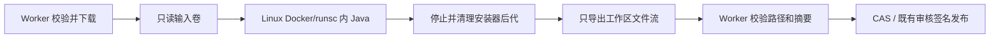

# Docker / gVisor 统一执行

本页描述现有 Worker 的 Docker/gVisor 模式，不接入 Argo。当前设置页也可显式选择裸机，模式选择、状态和实例列表见 [运行环境管理](execution-management.md)；裸机不具备本页的容器边界。下述协议与验收结果分别记录，部署支持不等于已完成目标机器验收。

## 信任与协议

Worker 持有现有数据库、下载、OSS 和签名权限；安装器不持有这些凭据。Docker 管理权限属于受信 Worker，不能暴露给安装器。Docker daemon 和镜像管理员仍属于受信基础设施。



协议 v1 由不可变输入清单（相对路径、字节数、SHA-256）、所需目录树（包含空目录）、有序 Java 步骤（classpath、Main-Class、参数）、明确产物路径和摘要要求组成；宿主路径单独绑定，不进入可序列化计划。执行前创建声明的产物父目录。资源和镜像由服务端部署策略决定。仅可信适配器可生成计划，不提供组织用户上传任意命令/挂载的接口。输入摘要、计划摘要、镜像和策略版本共同确定执行身份。

Forge/NeoForge 继续使用现有来源、处理器白名单、依赖和输出校验。下载全部由现有下载器完成，容器关闭网络。现代 Fabric Carpet 等无需运行程序的来源继续使用原导入流程，不为了统一协议而额外执行代码。

## 执行边界

- 强制 Linux Docker daemon、原生 amd64/arm64 镜像、固定镜像摘要、runsc；缺失或不匹配直接失败，不回退宿主 Java/runc。
- 输入通过 tar 流送入独立只读命名卷；不使用宿主 bind mount，兼容 macOS VM 与 Linux 的不同文件路径。
- 工作区与临时目录使用有大小上限的 tmpfs，内存/交换、CPU、PID、文件描述符、时限、日志均有上限；只读根文件系统、断网、禁止提权。
- 安装器始终 UID/GID 65532、零有效/允许 capabilities。镜像内受信生命周期辅助进程为 UID 0，仅有 KILL，用于收集前冻结并杀死该 UID 的所有后代；无其他宿主权限。随后受信 tar 以 UID 65532 导出。任何冻结/清理失败均不接收产物。
- 宿主独立解析产物 tar，拒绝路径越界、大小写冲突、链接、设备/FIFO 等特殊文件，检查数量与大小，重新计算摘要及不可变输入校验。只将适配器指定的产物复制回构建目录，再经过现有审核/签名门槛。
- 容器自带独立于 Worker 的到期退出；命名卷与容器带 namespace、执行 UUID、截止时间标签，Worker 和独立 janitor 仅回收本 namespace 的过期资源。Docker 容器名提供跨 Worker 进程的并发槽位。

## 可用性

现有 PackageBuild 租约负责进程崩溃后的重试，执行尝试使用独立 UUID 和输入卷。Docker 暂时不可用或 Worker 正常退出时延迟重排，不把未校验结果标为 READY。孤儿资源由定期 janitor 回收。节点本身、VM 或 Docker 同时停止时不能提供跨节点无中断运行；需要至少两个 Worker 节点和共享 PostgreSQL/OSS 才能覆盖单节点故障。本实现保留现有数据库租约仲裁。

Linux 在现有 Worker 机器配置 runsc。macOS 的 Worker 通过固定 context 连接专用 Colima Linux VM，Intel 与 Apple Silicon 都使用 VM 的原生架构；不在 Darwin 内核直接运行 gVisor，不依赖 Docker Desktop 默认 VM 可安装自定义 runtime。Linux systemd 与 macOS launchd 配置负责 Worker/VM 重启和 janitor。上线前须实测 Docker 重启、Worker 崩溃、资源限额和节点重启。

## 验收要求

协议和适配器测试覆盖输入/输出摘要、路径、错误隔离、取消及模板边界；Docker 传输测试不作为 gVisor 验收。真实隔离验收必须运行 runsc 指纹、非 root 权限、断网、只读输入/根目录、资源耗尽、遗留子进程和超时/回收测试，并验证真实 Forge/NeoForge 样例。macOS 与 Linux 实机结果分别记录，不能用模拟平台或 Windows Docker Desktop 结果替代。

依据：[gVisor Docker](https://gvisor.dev/docs/user_guide/quick_start/docker/)、[gVisor rootless](https://gvisor.dev/docs/user_guide/rootless/)、[Docker 资源限制](https://docs.docker.com/engine/containers/resource_constraints/)、[Colima 配置](https://github.com/abiosoft/colima/blob/main/embedded/defaults/colima.yaml)。

## 部署步骤

需要 Node 24、完整项目依赖（CLI 使用 tsx）、Docker CLI 和原生 Linux amd64/arm64 daemon。镜像与 runtime 由管理员预先安装，任务不会执行 pull、build、安装系统软件或修改 daemon。统一协议当前开放 Java 步骤；未来 Rift 等通过可信适配器生成同一计划，额外联网需求必须另外设计下载适配器。Carpet 的普通 Fabric 模组沿用分发，不强制执行安装器。

Linux 使用已有 Worker 主机即可，建议专用 daemon/context；不要把管理 socket 挂进安装器。由管理员从 [gVisor 官方发布](https://github.com/google/gvisor/releases) 审查一个确切 point release，取得对应 `x86_64`／`aarch64` 的完整 `gvisor.tar.bz2` SHA-512，设置以下变量后执行。脚本保留整套 `gvisor-bin`，合并并备份 Docker 配置，不自动重启 Docker。不要只复制单个 runsc，近期官方发行已拆分 sidecar 文件，见 [安装说明](https://gvisor.dev/docs/user_guide/install/)。

```sh
sudo env RUNSC_VERSION=YYYYMMDD.N RUNSC_SHA512=<128位已审查摘要> \
  sh deploy/execution/install-runsc.sh
# 在维护窗口 reload/restart 目标 Docker daemon，再进行后续检查。
```

脚本要求 Linux 上有 curl、python3、sha512sum、tar/bzip2；不自动 apt upgrade。rootless daemon 可显式指定用户拥有的 `RUNSC_INSTALL_ROOT`、`RUNSC_DAEMON_CONFIG`，但仍必须通过实际 cgroup／身份检查；rootless 资源委派依赖宿主配置，不能只因 Docker 启动成功就视为合格。部署目录及 runtime 只能由管理员写入。Docker 管理者属于受信边界，其权限不能授予组织用户。

macOS 13+ 先安装并审查 Colima/Docker CLI，然后执行专用配置生成器；不会覆盖既有 profile 或改变默认 Docker context。Intel/Apple Silicon 各自选择对应 runtime 包摘要。生成的 VM 默认 4 CPU、10 GiB RAM、60 GiB 数据盘，关闭异构模拟、SSH agent 转发及默认 home 共享；只挂载一个只读 provisioning 目录。`systrap` 不依赖嵌套 KVM。专用 VM 按需安装 curl、python3、bzip2 等依赖。首次启动联网安装，后续检查本地完整包标记，固定版本不在每次启动更新。

```sh
RUNSC_VERSION=YYYYMMDD.N RUNSC_SHA512=<对应本机架构摘要> \
  sh deploy/execution/configure-macos.sh
colima start --profile union-link --foreground
# 另一个终端或 Worker 配置：
export SANDBOX_DOCKER_CONTEXT=colima-union-link
```

构建镜像时分别提供经过审查的 Node 24 bookworm-slim 和 Temurin 21 jre-noble 摘要。两者须包含目标 daemon 原生架构；不要把 amd64 专用摘要用于 ARM。构建 context 仅含 `deploy/execution`，不包含项目 `.env`、数据库或签名文件。构建命令输出固定镜像 ID；每个节点都需要构建／预装该镜像。后续可在私有 registry 分发相同 OCI manifest digest。

```sh
export SANDBOX_NODE_BASE='node@sha256:<完整摘要>'
export SANDBOX_JAVA_BASE='eclipse-temurin@sha256:<完整摘要>'
npm run sandbox:image
export SANDBOX_JAVA_IMAGE='sha256:<命令输出>'
npm run sandbox:check
npm run sandbox:verify
```

完整配置见 `.env.example`。Worker 启动后持续上报能力状态；Docker 模式的每次实际执行仍须通过 runsc 身份和策略验证，未就绪的任务排队等待，不自动切换裸机。默认单槽：容器内存/交换共 6144 MiB、Java heap 2048 MiB、工作区 2048 MiB、临时区 256 MiB、CPU 2、PID 256，单步 600 秒、整次 1800 秒、日志 64 KiB，输入／产物总大小各限 1024 MiB。工作区文件总量还受 tmpfs 与输入+输出上限约束。调高槽数必须按 `slots × memoryMiB` 以及 VM/宿主剩余容量预算，避免影响数据库和 Web。输入卷为磁盘占用，输入拷贝先获取槽位；宿主磁盘／OSS 仍需容量监控。

## 服务管理和恢复

Linux 模板是 `deploy/execution/union-link-worker.service` 与 `union-link-sandbox-reap.service/.timer`。按实际 Node 路径、工作目录和运行账号修改，配置文件 root 管理、0600；Worker 环境保留既有受限数据库／OSS／签名设置，`sandbox.env` 只包含 SANDBOX 设置。配置与代码校验后安装到 `/etc/systemd/system`，`systemctl daemon-reload`，启用 Worker 和 reap timer。模板不代理／重启现有 DB、OSS。使用 rootless daemon 时移除 docker group，显式设置已审查 context 和相关用户 socket 配置。

macOS 的三个 `.plist.example` 分别监督 Colima VM、Worker、独立 janitor。将账号、HOME、仓库、Node/Colima 的绝对路径改成实际值（Intel Homebrew 通常 `/usr/local/bin`），创建日志目录并安排轮转。Worker 读取 `worker.env`，janitor 读取只含 sandbox 设置的 `sandbox.env`。若作为系统 LaunchDaemon 启动，文件需 root:wheel、0644，使用专用非 root `UserName`，安装到 `/Library/LaunchDaemons` 后 `launchctl bootstrap system <文件>`；不要让 Worker 以 root 运行。VZ/Colima 的无登录冷启动必须在该 macOS 版本实机验收，模板本身不是开机恢复证明。若改为用户 LaunchAgent，去掉 `UserName/SessionCreate` 并使用 gui domain，但其登录依赖不满足无人值守开机恢复目标。

相同 daemon 的 Worker 使用同一 namespace/slots 配置；槽名由 Docker 原子创建，实际执行及清理使用不可变容器 ID。Docker 不可用或执行节点配置不合格时每 30 秒重排，以便健康节点接手，不消耗三次崩溃重试预算；正常退出取消执行并重排，进程崩溃由 120 秒数据库租约重新领取。旧容器在整次期限到达时自行退出，janitor 每 30 秒删除过期容器和输入卷；Docker 不可用时，下次成功连接继续回收。Docker 响应丢失可能留下未确认的资源，仍由标签截止时间兜底，故障恢复可能等待完整截止时间。没有写入新 READY 或发布的捷径。

单主机部署提供受限恢复时间，无法承诺硬件故障期间持续处理。若要求节点故障时继续接单，应部署至少两台 Worker、共享受保护的 PostgreSQL/OSS，并分别安装本机执行器；跨主机任务由现有数据库租约协调。无需 Argo。Docker socket 与 runtime 不对公网开放。

## 验收命令与记录

`npm run test:execution` 是离线协议、恶意归档、Docker 传输替身及 Forge 迁移测试；普通 `npm test` 同时验证数据库流程中的延迟重排／退出取消。`sandbox:check` 实际启动 runsc 探针，检查镜像/架构、内核指纹、UID、capabilities、NoNewPrivs 与 Java；不满足即非零退出。

`sandbox:verify` 先执行真实检查，再使用独立随机 namespace 编译并运行仓库内的可信 Java 21 探针，需要 JDK 21 的 javac/jar（可通过 SANDBOX_JAVAC_BIN/SANDBOX_JAR_BIN 指定）。这两个编译工具只用于验收固定源码，不用于处理安装器。探针逐项验证断网、凭据边界、根目录/输入只读、遗留后代停止、tmpfs 耗尽、PID 上限、链接产物拒绝、输入改写拒绝、超时、Java heap 限制、日志溢出、取消及每次资源清空；仅接受相应错误类型，基础设施故障不能冒充通过。CPU/cgroup 硬限制由 daemon 能力和容器 inspect 校验；Java OOM 不等于验证了宿主 OOM killer。

目标机另须验证：真实 Forge 1.20.1/47.4.0、NeoForge 1.21.1/21.1.256 的完整新缓存构建与签名；Linux amd64/arm64、Intel/Apple Silicon macOS 分别留档运行时版本、镜像摘要、OS/内核、探针结果和耗时。模拟架构不算实机。故障矩阵还包括执行中 kill Worker、Docker daemon 重启、整机/VM 冷启动、数据库短时不可用与两节点租约交接，检查单次发布、无错误 READY、无跨任务污染与截止时间后资源回收。会中断服务的故障注入在专用验收节点执行。

2026-10-25 本机状态：Windows Docker Desktop daemon 未配置 runsc；`sandbox:check` 已实际返回 `docker-runtime-or-cgroups` 配置失败，未创建探针，未回退 runc。本机可信 Java 探针源码可编译。固定摘要 Node 24 + Temurin 21 镜像构建通过，独立 runc 传输测试通过输入 tar、非 root/零 capabilities、断网/只读探针、后代停止与 tmpfs 文件流校验，并清空测试容器/卷；这不是隔离验收。Linux/macOS 原生隔离、真实 Forge 处理器与故障注入仍需目标机执行，不能将离线测试或 Docker 字段核对表述成生产隔离／高可用验收完成。
