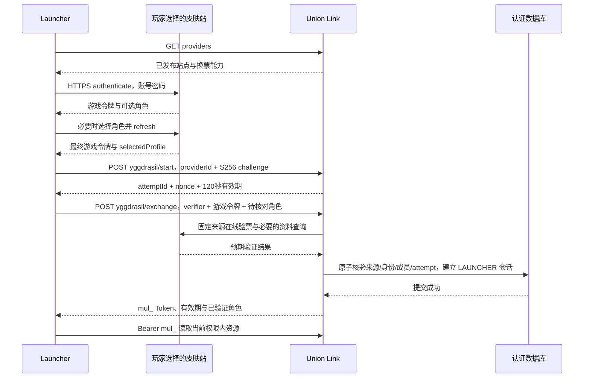

# Launcher 外置登录与 Launcher Token 签发开发方案

日期：2026-10-21。状态：待实施的开发设计，本文不表示接口、数据库迁移或启动器功能已经完成。

2026-10-22 后续：后端已实施，实际接口、配置及验证边界见 [换票实施说明](launcher-game-token-exchange.md)。下文保留设计阶段原文；真实来源逐站验收和原生启动器接入仍未完成。

目标：玩家手动选择联合皮肤站，在启动器完成该站的账号密码登录和角色选择后，由 Union Link 验证游戏令牌、账号与 game profile 的归属关系，签发只用于成员资源读取的 Launcher Token。玩家无需再次输入 Union Link 密码。

本文补充 [Union OAuth 与成员访问方案](union-oauth-member-access-plan.md)，实施时保留 [现有浏览器登录桥接](union-oauth-member-access.md) 和传统账号密码入口。项目仍处于开发期，可以调整 API，不提供匿名或旧协议兼容旁路。

## 1. 确定范围与现有基础

### 1.1 本次设计采用的产品规则

- 玩家手动选择皮肤站，不按邮箱、角色名或密码自动猜测站点，不遍历其他站点试密码。
- 皮肤站密码只从启动器发往玩家选定且已核准的认证服务器；Union Link 不代理账号密码登录。
- 游戏账号认证成功后，启动器请求 Union Link 换票；两部分分别记录成功或失败。
- 外部身份继续采用与 Union OAuth 一致的完整 `CODE:UID`，不能用角色 UUID、昵称、邮箱或跨站绑定关系代替。
- 首次普通入组为 PLAYER，不授予后台管理、审核或发布权限。已有显式权限、停用和归档状态沿用当前规则。
- 同一皮肤站账号下的多个游戏角色使用同一个 Union Link 账号及其资源权限；本方案不增加按游戏角色划分组织资源的规则。
- 跨组织资源继续使用现有申请、审批和撤销机制，不能因为角色跨站绑定而自动获得其他组织资源。
- 本次只设计启动器 API 会话；浏览器网站 Cookie 不随换票自动登录。

### 1.2 已核对的项目实现

| 能力 | 当前实现 | 本方案的变化 |
| --- | --- | --- |
| 网页 Union OAuth | `src/lib/union-oauth.ts`，oauth4webapi、一次性 state、S256 PKCE、独立短期 Cookie | 继续保留；抽取可共用的身份解析和普通入组逻辑 |
| 浏览器领取 Launcher Token | `src/lib/launcher-auth.ts`，`start` → 浏览器确认 → `claim` | 保留为独立方式及不支持直接换票站点的入口 |
| Launcher Token | `mul_` + 32 字节随机数的十六进制编码，`Session.kind=LAUNCHER`，数据库保存去掉前缀后随机值的 SHA-256 | 继续采用不透明令牌；直接换票新增较短有效期和认证来源记录 |
| 现有会话时长 | `SESSION_SECONDS` 为 12 小时 | 直接换票会话上限改用本方案的 15 分钟；不静默套用 12 小时 |
| 成员读取 | `src/lib/member-access.ts`，每次检查会话和实时资源授权，分发返回前再次核验 | 增加直接换票来源停用、修订失效检查 |
| 组织目录 | `UnionSkinSite` 保存 CODE、组织、主地址及地址别名 | 作为发现资料；不因同步到域名就自动授权该域名参与换票 |
| 外部账号 | `UnionIdentity.subject` 唯一，当前 `accountId` 也唯一 | 复用既有完整 subject；本方案不实现多个外部账号合并或绑定 UI |

截至本文编写，项目没有直接 Yggdrasil 换票接口，也没有完成原生 Launcher 的这条登录流程。公开认证元数据、上游源码和模拟测试均不能代替真实游戏令牌验收。

## 2. 身份与 game profile 的安全模型

### 2.1 必须区分的三类数据

| 数据 | 示例或内容 | 用途与信任边界 |
| --- | --- | --- |
| 皮肤站账号身份 | 来源站的 UID，经映射成为 `MUA:123` | 决定关联哪个本地账号、默认加入哪个组织，必须由可信上游证明 |
| game profile | 游戏角色 UUID、名称，可能还有皮肤属性 | 表示当前选中的游戏角色；启动器提交的内容只是待核对声明 |
| 游戏 accessToken | 皮肤站签发的访问令牌 | 用来证明账号及角色归属，属于敏感 Bearer 凭据 |

UUID 和角色名通常是可公开查询的信息，不是登录凭据。`properties.textures.signature` 即使有效，也不能单独证明请求者拥有这个角色。TLS 用于传输保护，上游验票及账号—角色归属校验用于防止伪造身份，两层都必须具备。

Union 的角色绑定和 UUID 重映射可能改变游戏展示结果；`backend_scopes.bind/all` 不能作为本地账号归属或组织授权依据。本站只使用所选认证来源的可信账号身份建立 `CODE:UID`。

### 2.2 验证器的唯一成功出口

后端为每种已核准的上游实现单独适配器。只有适配器完成校验后，才能在服务端内存中创建以下事实对象：

```ts
type VerifiedGameIdentity = {
  providerId: string;
  providerRevision: number;
  unionSubject: string; // 与 Union OAuth 完全一致的 CODE:UID
  upstreamUid: string;  // 十进制字符串，禁止经过 JS Number 精度转换
  profile: { id: string; name: string };
  upstreamExpiresAt: Date;
  verifiedAt: Date;
  verificationMethod: "MUA_YGGC_ONLINE_V1" | "TRUSTED_IDENTITY_ENDPOINT_V1";
};
```

这是模块内部类型，不是接受客户端 JSON 的认证证据。不得让业务层将请求体强制转换成该类型，或允许客户端选择 `verificationMethod`。

成功条件必须同时满足：

1. 上游来源是服务端已核准的 provider，且来源配置、站点及组织仍然有效。
2. 当前游戏令牌真实有效、未被上游撤销，且账号未被上游封禁。
3. 账号 UID 的语义和现有 Union OAuth 的 UID 一致。
4. 选中的 game profile 属于该令牌对应账号，且与请求中声明的角色 UUID 一致。
5. 上游有效期已得到可信证明，有足够剩余时间签发本地短期 Token。

任何一项无法证明，就不能创建本地会话；不能退化为相信启动器传来的 `uid`、`user.id`、UUID 或昵称。

### 2.3 首个适配器：经核实的新版本 MUA Yggdrasil Connect

已阅读的上游 `AccessToken` 实现会校验 JWT 签名，将 `sub`、`aud` 与令牌数据库记录核对，按 `user_id` 找账号，并检查 `selectedProfile` 对应角色属于该账号。`/authserver/validate` 经中间件检查成功后只返回 204，不直接返回 UID。

因此可以设计以下适配方式，但每个真实站点必须先完成第 11 节验收：

1. 在固定 provider 的 `/authserver/validate` 提交收到的**同一串原始游戏令牌**，可带适配器要求的 `clientToken`；要求 HTTPS、禁止重定向，只接受预期的 204。
2. 只有验票成功，才将该令牌的 JWT 内容视为被这个上游认证过的数据。先验票后使用声明；单独 Base64 解码不能完成认证。
3. 适配器限定已核实的 RS256 结构和字段语义，再检查 `sub`、`selectedProfile`、`exp`、`nbf`（若有）等。`aud` 是该上游令牌体系的 audience，不能误用 Union Link 的 OAuth Client ID。
4. 传统认证签发的令牌可能没有 `iss`；仅此已核实适配器允许缺省，并用固定 provider 配置确定来源。其他发行者、Janus 令牌或新的结构需要独立核实，不自动套用。
5. 要求 `sub` 为可规范化的站内数字 UID，`selectedProfile` 非空，且其 UUID 与客户端声明一致。生成 `CODE:UID`，不使用认证响应中可能为派生 UUID 的 `user.id`。
6. 从同一已核准来源的 `/sessionserver/session/minecraft/profile/{uuid}` 读取有界资料，要求返回 UUID 与已验证的 `selectedProfile` 一致，只提取 UUID 和当前角色名。公开资料查询用于补充名字，不能替代步骤 1–5 的归属证明。
7. 若返回 UUID 与选中角色存在重映射差异、角色被删除、名称刚变化或上游响应不符合该适配器合同，失败并要求重新完成角色选择或更新适配器；不自行猜测映射。

该方案依赖上游确实对**完整令牌**进行签名、账号和角色归属校验；不能只因服务返回 204 或版本字符串相同就启用。若采用本地 JWT 验签增强校验，必须使用另行核准的令牌签名公钥，不能拿材质 `signaturePublickey`、Union 站间公钥或 OAuth 用户信息签名公钥代用。仅本地验签也不能替代在线撤销检查。

本地提取声明使用成熟 JWT 解析库并限制大小，校验失败统一拒绝；不编写自制签名或加密算法。oauth4webapi 继续服务 OAuth 流程，不负责实现 Yggdrasil 协议。

### 2.4 旧版及其他皮肤站

旧版可能使用不同意义的 JWT `sub` 或不透明令牌。不能把“看起来像 JWT”当成兼容依据，更不能将旧版的邮箱派生 UUID 当成数字 UID。

对于不能从现有合同证明 UID 和角色归属的站点，提供两个明确选项：

- 使用现有 Union OAuth + 浏览器 Launcher 桥接取得本地 Token；游戏登录结果独立保留，不宣称已经证明它与该网页账号相同。
- 上游实现或开放可信的身份查询接口后，再启用直接换票适配器。

未来身份接口的**建议合同**是：后端向固定上游通过 HTTPS 提交游戏令牌及本次 challenge；上游验证后返回账号 UID、选中角色 UUID/名称、到期时间，并回传 challenge。它不是当前联盟已有接口。上游若使用签名响应，须绑定本站 audience、provider、challenge、有效期及唯一凭据 ID，并使用已核准密钥；也可以采用固定 HTTPS 服务端直连的可信响应，不强行自建多层加密协议。

`join/hasJoined` 能用于游戏角色持有证明，但本身不补足 Union OAuth UID；首版不调用它来换票，也不改动玩家进服记录。不调用 `refresh` 来探测身份，因为刷新可能撤销启动器正在使用的游戏令牌；不调用 `invalidate` 验票，因为它可能对无效令牌也返回 204。

## 3. 站点选择与来源配置

### 3.1 两层资料

`UnionSkinSite` 继续表示同步目录与组织映射。新增 `LauncherAuthProvider` 表示**具体认证来源**，建议字段如下：

| 字段 | 说明 |
| --- | --- |
| `id` | 稳定 UUID；一个 CODE 可以有多个 provider |
| `siteCode` | 对应目录 CODE；组织由既有映射得到 |
| `displayName` | 例如“MUA 官方皮肤站”或具体域名，供用户确认 |
| `bsRoot` / `authApiRoot` | 已核准的 HTTPS 站点和认证 API 根地址 |
| `adapter` | 指定已实现并通过验收的适配器，不允许客户端填写 |
| `enabled` / `revision` | 仅超管配置；修改认证根地址、适配器或身份映射时递增修订 |
| `subjectMapping` | 已核实的 OAuth UID 对照规则和账号命名空间说明 |
| `verifiedAt` / `verifiedBy` | 最近验收时间、执行者；不保存验收用原始令牌 |

目录同步可生成待核查记录，不能自动启用直接换票；目录域名变化也不能自动让新地址继承发送密码和游戏令牌的资格。已核准地址不再属于有效目录地址时，暂停该 provider 并重新核实。

YITUEM 的两个域名属于同一组织，但不能仅据此认定两套认证服务的 UID 命名空间相同。两个地址要分别验证它们与 Union OAuth 的 subject 对应关系；无法排除同 CODE、同 UID 指向不同人的情况时，不开启冲突来源的直接换票。不得仅按组织或数字 UID 合并账号。

### 3.2 API 发现与网络边界

- 启动器从本站读取已发布的 provider 列表，用户选择具体站点；显示即将接收密码的域名。
- 服务端保存最终认证 API 根地址。`X-Authlib-Injector-API-Location` 只用于核准过程中的发现，不能在携带凭据的请求里自动接受新 Origin。
- 启动器不能向 Union Link 提交自选 `authServerUrl`，换票请求只带 `providerId`。
- 认证、验票和资料请求都禁止自动重定向；需要迁移域名时先核准配置。
- 服务端沿用现有公网地址保护：拒绝私网、回环、链路本地及云元数据地址，解析后固定连接地址并保持正确的 Host/SNI 和证书校验，防止 DNS 重绑定；不能直接照搬会绕过这些校验的普通 `fetch`。
- 初始建议上游总超时 10 秒，单响应上限 64 KiB，每 provider 并发上限 4；失败关闭，不切换到其他认证站或降级 HTTP。
- 本地开发的 Union Link Origin 使用 `https://link.mualliance.cn`；外部皮肤站的凭据请求仍需真实 HTTPS。反向代理到本地的 HTTP 段仅允许同机回环或受保护通道，不应穿过不可信网络。

## 4. 完整流程与接口合同

### 4.1 调用顺序



必须在游戏角色选择与必要的游戏令牌刷新完成后换票。存在多个角色、尚无选中角色时，不先创建 Union Link 会话。

以下三个新接口均为拟新增接口，不能写成当前可用 API。

### 4.2 `GET /api/auth/launcher/providers`

未登录可读，仅公开显示名称、provider ID、CODE、已核准站点/认证根地址、直接换票支持状态、配置修订和浏览器登录可用性。不得返回私钥、成员站密钥、OAuth Secret、内部失败栈、用户信息或超管配置。

列表不开放未核准的认证地址。对支持浏览器登录但不支持直接换票的站点，返回明确能力标记，让 UI 提供浏览器入口；不诱导用户认为密码登录会同时完成本站登录。

### 4.3 `POST /api/auth/launcher/yggdrasil/start`

请求示意：

```json
{
  "providerId": "<provider UUID>",
  "codeChallenge": "<BASE64URL(SHA256(codeVerifier))>",
  "codeChallengeMethod": "S256"
}
```

`codeVerifier` 由启动器使用安全随机源生成 32 字节并编码成 43 字符 base64url，只留在当前登录流程内存中。服务端校验 provider 能力后创建独立的 `LauncherGameLoginAttempt`，固定 provider ID 和修订，不复用浏览器 `LauncherLoginAttempt`。

响应示意：

```json
{
  "attemptId": "<attempt UUID>",
  "nonce": "<32字节随机值的base64url>",
  "expiresIn": 120,
  "providerId": "<provider UUID>",
  "providerRevision": 1
}
```

数据库只保存 nonce 摘要、challenge 和过期时间。nonce 是本次尝试的关联值，不是替代游戏身份验证的凭据。

### 4.4 `POST /api/auth/launcher/yggdrasil/exchange`

请求示意，所有占位值只用于说明字段：

```json
{
  "attemptId": "<attempt UUID>",
  "nonce": "<start响应中的nonce>",
  "codeVerifier": "<当前登录流程内存中的verifier>",
  "gameAccessToken": "<皮肤站签发的最终游戏令牌>",
  "gameClientToken": "<适配器要求时提供>",
  "gameProfile": {
    "id": "<选中角色的UUID>",
    "name": "<启动器当前显示的角色名>"
  }
}
```

只接受 JSON POST、最大 32 KiB，严格拒绝额外字段。游戏令牌最大 16 KiB，clientToken 最大 256 字节；若真实上游超过这些边界，应核实后调整合同，不能截断凭据。UUID 只接受标准带连字符或 32 位十六进制格式，统一为小写 32 位；不按名字生成 UUID。名字可省略，提供时限制长度并拒绝控制字符，最终采用上游核实后的名字。

请求不接受 `accountId`、`sub`、`organizationId`、角色/权限数组、URL 或完整 `GameProfile.properties`。客户端提交的 `gameProfile.id` 是必须核对的目标，`name` 只是显示一致性提示；名字不一致返回 `PROFILE_CHANGED`，让启动器更新角色资料后重新发起，不能覆盖上游事实。

后端按以下顺序处理：

1. 校验 JSON、大小、来源请求策略和限流；失败计数必须独立提交，不能随业务事务回滚。
2. 校验 attempt 未过期、nonce 摘要及 S256 challenge，常量时间比较；错误响应不回显任何凭据。
3. 原子将 `PENDING` 更新为 `VERIFYING`，同一 attempt 最多一个请求进入上游验证。
4. 在数据库事务外执行 provider 适配器，取得 `VerifiedGameIdentity`。
5. 短事务内重新检查 attempt 有效期、状态、provider 修订、站点、组织、账号/成员状态及上游剩余有效期。
6. 调用受限身份解析/普通入组函数，复用既有 subject；新账号的展示名在没有可信账号昵称时使用 `Union · CODE:UID`，不把角色名冒充 OAuth 昵称。不得恢复人工停用成员或覆盖已有授权。
7. 使用安全随机源生成本地 Token，创建 `kind=LAUNCHER` 的会话，写入已验证角色和认证来源元数据，同时将 attempt 改为 `CONSUMED`。两者在同一事务提交。
8. 提交成功后只在本次 HTTPS 响应返回原始本地 Token，之后不能从数据库取回明文。

成功响应示意：

```json
{
  "tokenType": "Bearer",
  "token": "mul_<64位随机十六进制值>",
  "expiresAt": "<UTC ISO时间>",
  "expiresIn": 900,
  "account": { "id": "<本地账号UUID>", "unionSubject": "MUA:123" },
  "gameProfile": { "id": "<已验证UUID>", "name": "<已验证角色名>" },
  "providerId": "<provider UUID>"
}
```

`expiresIn` 实际值按第 6 节计算，900 是最大值示例。响应不返回游戏令牌、密码、clientToken、未经验证的皮肤属性或后台角色。该接口不设置 `mua_session` Cookie。

若响应丢失，不保存可恢复的明文 Token，也不让同一 attempt 重放领取。启动器使用仍有效的游戏令牌新建 attempt；无法领取的旧本地会话在短期到期后清理。需要改善此体验时另行设计安全恢复机制，不能临时加入明文 Token 缓存。

### 4.5 状态与错误

attempt 状态：`PENDING → VERIFYING → CONSUMED`，失败进入 `FAILED`，到期不可再用。`VERIFYING` 进程崩溃后等待清理，不恢复为 `PENDING`。正常失败也要新建尝试，不在同一 attempt 重试上游。

| HTTP | 业务错误码 | 启动器行为 |
| --- | --- | --- |
| 400 | `INVALID_REQUEST` / `LOGIN_ATTEMPT_INVALID` | 修正参数或新建尝试，不显示凭据细节 |
| 401 | `GAME_TOKEN_INVALID` / `GAME_TOKEN_EXPIRING` | 由启动器刷新游戏令牌或重新登录，再建尝试 |
| 403 | `ACCOUNT_DISABLED` / `PROVIDER_DISABLED` | 停止自动重试；不切换其他账号或站点 |
| 409 | `PROFILE_MISMATCH` / `PROFILE_CHANGED` / `PROVIDER_CHANGED` / `LOGIN_ATTEMPT_USED` | 重新确认角色、站点或新建尝试 |
| 413 / 415 | `REQUEST_TOO_LARGE` / `JSON_REQUIRED` | 修正客户端实现 |
| 429 | `RATE_LIMITED` | 按 `Retry-After` 等待，停止高频重试 |
| 502 / 503 | `UPSTREAM_UNAVAILABLE` / `IDENTITY_PROOF_UNSUPPORTED` | 保留游戏登录状态，显示本站登录失败及浏览器入口 |

统一 JSON 错误结构为 `{ "error": "可本地化提示", "code": "稳定错误码", "requestId": "随机追踪ID" }`；这是新接口合同，不据此宣称当前所有 API 已支持业务错误码。

## 5. game profile 与敏感信息的传输保护

### 5.1 传输和请求隔离

- 启动器 → 皮肤站、启动器 → Union Link、Union Link → 皮肤站都使用正确验证证书和主机名的 HTTPS；禁止信任所有证书、自定义关闭校验或回退 HTTP。
- 账号密码、游戏 Token、本地 Token、clientToken、verifier 都不得进入 URL、查询参数、浏览器导航、剪贴板、错误报告或遥测。
- 游戏令牌只出现在换票 JSON 及对固定上游的验票 JSON；本地 Token 只出现在签发响应及本站请求的 `Authorization` 头。
- 请求客户端按 Origin 隔离，不把本站 `Authorization`、Cookie 或游戏凭据带到 OSS、下载刷新后跳转的地址、皮肤图片或其他站点；请求拦截器不能全局附加 Token。
- 认证响应统一 `Cache-Control: private, no-store`；POST 不缓存，日志/代理/APM 不采集请求体、响应体或认证头，不自动重试含凭据的认证请求。
- 原生客户端请求可没有 `Origin`；若存在，只接受本站精确 Origin，并拒绝跨站 Fetch Metadata。不开启通配认证 CORS；Cookie 不参与这些接口的账号判定。Origin、CORS、User-Agent 都不能证明客户端是官方启动器。
- 本站不额外发送整份 Minecraft `GameProfile`；仅传 UUID、必要的名称声明。皮肤属性及图片不参与签票，图片若需预览，另按安全读取和域名策略实现。

### 5.2 日志与保存

| 项目 | Union Link | Launcher |
| --- | --- | --- |
| 密码 | 不接收、不保存 | 登录请求后清空，不提供明文“记住密码” |
| 游戏 accessToken / clientToken | 仅验证请求内存中使用，不写库、缓存、队列、审计或重试任务 | 运行时按需保留；持久化只能进入操作系统凭据保管设施 |
| Launcher Token | 只存随机部分 SHA-256，不能以 Token 本身作日志字段 | 默认内存；需要持久登录时使用操作系统凭据保管设施 |
| verifier / nonce | verifier 不保存，nonce 只存摘要 | 尝试结束即清除内存引用 |
| 已验证 profile | 会话元数据只保存 UUID、当前名、来源、核验时间和账号关联 | 缓存用于 UI，不作为服务端身份凭据 |

不能用写在 JAR、配置文件或源码里的固定“加密密钥”保护持久令牌。操作系统凭据保管不可用时降级为仅内存，不降级为明文 JSON；JVM 中清除引用不等于能保证抹除所有内存副本，文档与 UI 不作此承诺。

现有上游源码包含将 accessToken 写入日志的语句。上线前必须与实际站点确认认证日志、反向代理和 APM 已脱敏；本站脱敏不能保证上游未泄漏。验收使用专用低权限测试账号，避免将真实玩家令牌写入测试工件。

### 5.3 一次性校验能保护什么

S256 verifier、nonce、短期 attempt 和原子消费用于防止领取尝试被劫持、重复执行或混用来源；它们不是给上游游戏令牌增加持有者绑定。攻击者如果已经取得有效的游戏 Bearer Token，仍可能自行新建 attempt 换票；被盗的本地 Bearer Token 在撤销或到期前也可能被重放。

首版安全目标是防止网络窃听、传输篡改、伪造 profile、跨来源混用及本次尝试重复签发，并通过短有效期、脱敏和安全存储缩小令牌泄漏后果。不能写成“nonce/PKCE 使被盗 Token 无法使用”。

若后续要求“仅拿到本地 Token 也不能调用 API”，应实施标准 DPoP 或其他成熟的持有者约束机制：签发时绑定公钥、每次资源请求验证 proof、`htu/htm/iat/jti/ath` 与重放状态，并同步修改令牌类型和 Launcher；仅在换票时加一个客户端签名达不到这个目标。它也不会自动解决上游游戏 Bearer Token 被盗的问题。首版不自创 RSA 加密信封或伪 DPoP。

## 6. Launcher Token 生命周期

### 6.1 签发与权限

继续采用 `mul_` 前缀和 256 位安全随机值，沿用现有摘要格式与 `Session.kind=LAUNCHER`。不把权限、角色、服务器列表、游戏令牌或整个 profile 塞进 Token。

直接换票会话到期时间：

```text
expiresAt = min(本地签发时间 + 15分钟, 可信上游到期时间 - 30秒)
```

上游剩余寿命扣除余量后不足 60 秒时返回 `GAME_TOKEN_EXPIRING`。上游到期时间无法可信取得时，当前适配器不签票，不能用客户端填写的时间或无限有效期补齐。

15 分钟和 30 秒是本项目的初始设计值，不是上游协议保证。浏览器桥接目前使用的 12 小时会话继续作为独立认证方式记录；本方案不把它写成受游戏到期时间约束的会话。

所有成员资源仍逐请求检查本地账号、会话、成员、授权及资源发布状态。管理员持有 Launcher Token 也只能走成员读取入口，不能打开后台或执行审核、发布。独立未绑定客户端、草稿和未发布资源不因登录方式变化而开放。

### 6.2 续期、切换和退出

- 首版不签发独立的 Union Link refresh token。启动器在本地 Token 临近到期时，使用当前有效游戏令牌重新执行 start/exchange；若游戏令牌需要刷新，由启动器按皮肤站协议完成。
- 同一账号的续期先取得并校验新响应，再替换内存 Token；旧 Token 最佳努力调用既有 `/api/auth/launcher/logout` 撤销。该退出接口现阶段要求有效 Token，不能把撤销失败等同于已撤销，旧会话最多按其剩余有效期存活。
- 重新换票必须重新执行上游验证，不因拥有旧 Launcher Token 而跳过。401 不回退 Cookie，也不无限刷新；最多进行一次受控刷新/换票后提示用户。
- 切换皮肤站、账号或角色时，先停止旧资源请求并清空旧账号列表/下载刷新上下文，撤销旧本地 Token，再验证新身份。异步响应按登录流程 generation 隔离，旧请求的迟到结果不能覆盖新账号。
- 已开始的大文件下载需要与旧授权上下文隔离；签名 URL 不跨账号复用或自动加入新账号缓存。权限撤销无法收回已下载文件或已经签发且尚未过期的 OSS URL。
- “退出 Union Link”撤销本地 Token；“退出皮肤站账号”由启动器按该站协议处理游戏令牌。Union Link 后端不擅自撤销游戏令牌，不影响其他游戏会话。
- 切换角色可能仍是同一个 `CODE:UID`，但新的会话 profile 必须重新核验；不得只改客户端显示名继续沿用旧会话的 profile 描述。

### 6.3 撤销传播边界

本地账号、成员或外部资源授权撤销继续实时阻止新的资源签发。直接换票 provider 或对应站点被停用、身份配置修订变化时，资源请求也必须拒绝该来源的直接换票会话。

上游游戏令牌被撤销或账号被封禁，并不会自动通知本站。首版不保存游戏令牌进行后台轮询；已签发本地 Token 的上游撤销传播窗口最长约为剩余 15 分钟。若要求更快，需要上游可信撤销通知或另外设计在线状态查询，不能宣称已实时同步。

## 7. 数据库、并发和 RLS

### 7.1 建议模型

新增 `LauncherAuthProvider`，见第 3 节；新增 `LauncherGameLoginAttempt`：

- `id`、`providerId`、`providerRevision`、`codeChallenge`、`nonceHash`。
- `status`、`createdAt`、`expiresAt`、`consumedAt`、可选的成功 `accountId` 和粗粒度失败码。
- 不保存游戏令牌、verifier、clientToken、密码或待验证的完整 profile。
- 索引覆盖到期清理及 provider；短期失败记录用于限流/排错，默认 24 小时内清理。

扩展 `Session` 的可空字段：`authMethod`、`providerId`、`providerRevision`、`unionSubject`、`gameProfileId`、`gameProfileName`、`upstreamExpiresAt`、`verifiedAt`、`gameLoginAttemptId`。

直接换票必须填写对应元数据，并对 `gameLoginAttemptId` 建唯一约束，防止同一 attempt 创建多个会话；旧 WEB/浏览器桥接会话允许这些字段为空。会话删除时原始凭据摘要与 profile 元数据一同清理，不建立可公开查询的账号—角色关联 API。审计按既有保留策略只记录必要的 actor、provider、动作、结果和时间，不复制整份角色资料。

### 7.2 身份解析与事务

现有 `union_login` 同时解析外部账号并创建 WEB 会话，不能原样调用后再把会话改成 LAUNCHER。应抽取受限的 `union_resolve_identity` 及普通入组逻辑，分别由网页和直接换票入口在各自原子事务中创建正确 kind 的会话；不产生临时管理/WEB 会话。

最终事务重新检查 provider 修订及停用状态，锁定/条件更新 attempt，并通过唯一约束处理同一 subject 的并发首次登录，避免重复账号和重复成员。组织映射变化导致验证期间事实失效时，拒绝本次换票。

在事务外处理所有网络请求，成功事实只在短时间内用于一次最终提交。最终提交失败不能在代码外另补建会话；失败清理不得把已消费 attempt 恢复。

### 7.3 数据库权限

- 新表启用并 FORCE RLS，继续使用 `mua_auth/mua_web/mua_public/mua_worker` 隔离运行连接及独立迁移角色；不使用 postgres/BYPASSRLS。
- `mua_auth` 只获得本流程必需的数据和受限函数；`mua_public` 不获得原始 attempts、会话或未投影 provider 表。匿名 provider 列表通过固定安全投影提供。
- provider 管理由超管 Cookie、服务端权限及受限数据库函数共同保护；PLAYER 和管理 API Token 不能配置认证地址。
- 扩展 `session_actor` 等函数，使直接换票来源停用/修订失效检查在应用层与数据库边界一致；不能只在列表 UI 隐藏来源。
- 新 SECURITY DEFINER 函数沿用非登录属主、固定 search_path、限定 EXECUTE 授权和现有审计约定。
- 使用新的追加迁移，不编辑已发布迁移。新表数量及数据库检查脚本随实际模型更新，本文不预先声明最终业务表数量。

### 7.4 初始限流与清理

采用已有数据库限流或等效多实例共享机制，至少覆盖：可信客户端 IP、provider、attempt、成功验证后的账号。IP 只接受已配置代理链来源，不能直接相信任意 `X-Forwarded-For`。

初始建议：每 IP 每 5 分钟创建 20 次 attempt，每 IP+provider 每 5 分钟验票 10 次，每 attempt 最多 5 次失败的 nonce/verifier 校验，每账号每 5 分钟最多 10 次成功签发；配合每 provider 上游并发上限及全局保护。真实校园 NAT 场景需压测并调整，不把共享出口误当成单一玩家，也不只使用容易伪造的 User-Agent 限流。

过期 attempt 定期回收；不能让清理正在有效期内的 `VERIFYING` 记录破坏最终事务。上游验证失败只记录稳定失败码，服务端错误日志不包含上游响应正文。

## 8. Launcher 侧实施要求

启动器仓库为 `G:\Projects\Minecraft\BotWMCS\launcher-template-26.1`，基于 Fabric/Minecraft 客户端；不能把一般桌面启动器的 JVM 参数方案直接当作此仓库已具备的能力。

建议将以下职责分开实现：

1. `AuthProviderRepository`：读取本站来源列表、保存用户选择，更新配置修订，不允许编辑任意密码接收地址。
2. `YggdrasilLoginService`：认证、角色选择、游戏令牌刷新，使用独立的站点 HTTP 客户端。
3. `LauncherIdentityService`：生成 verifier、调用 start/exchange、校验响应 profile/来源、保存本地短期 Token。
4. `CredentialStore`：操作系统凭据保管适配，平台判断沿用项目 `SystemCallout`，不引入另一套 OS 检测。
5. `MemberApiClient`：仅向配置好的 Union Link Origin 附加本地 Token，处理账号切换、401 和资源缓存隔离。

登录 UI 明确显示两种状态：“皮肤站登录成功”“Union Link 已连接/连接失败”。后者失败不抹掉有效游戏登录，不显示旧账号的资源列表；提供重试和浏览器登录入口。选择不支持直接换票的站点时提前说明该能力。

接收本站响应时再次核对 provider 和角色 UUID；不匹配时清除本地 Token 并报告流程错误。UI 名称来源是服务端已验证资料，但 UI 检查不是后端认证的替代。

游戏启动及运行中的身份更新是单独验收项：要确认当前 Minecraft 版本的 User、会话服务、皮肤获取和连接流程真正使用所选外置账号；只给子进程传一个 accessToken 或只改界面不能算完成。游戏 accessToken 与 `mul_` Token 不得互换。Launcher 中不能内置 Union OAuth Client Secret、成员站密钥或服务端私钥。

## 9. API 文档与现有入口

新增 provider/start/exchange 的中英文 OpenAPI schema、请求大小、错误码、无 Cookie 语义、敏感字段标记和例子；敏感字段不填真实示例、不设置实际默认 Token。

当前公开 OpenAPI 只发布四个 Launcher GET。实施本方案时有意调整公开子集：纳入 Launcher 必需的 provider、直接换票、成员自查和本地退出合同，并按实际 Launcher 浏览器入口需要公开 start/claim；后台管理规范仍受管理 Cookie 保护。认证接口公开文档不授予管理权限。

同步规范来源、生成 JSON、清单和兼容性说明，审查新基线；不手改生成文件冒充源变更。Scalar/调试器不能持久保存真实游戏令牌。现有 OAuth Cookie、state/PKCE 与密码表单安全保护继续单独测试。

## 10. 分步实施及完成条件

### 第 1 步：确认第一个真实 provider

先用 MUA 官方站建立专用测试账号，确认数字 UID、OAuth `sub`、最终令牌 `selectedProfile`、过期时间、账号封禁及令牌撤销行为；用两个账号和多角色做对照。登记上游精确版本/提交及核准地址，确认日志脱敏。

完成条件：能独立证明“账号 A 的令牌不能换到账号 B 的 profile”，且游戏登录得到的 subject 与 OAuth 登录一致。证据不留原始 Token；未达到时该来源保持直接换票关闭，不阻止浏览器方式。

### 第 2 步：模型、RLS 与身份共用逻辑

添加 provider、独立 attempt、Session 元数据和受限函数，抽取身份解析；验证 WEB 与 LAUNCHER 的权限隔离、并发唯一性、停用来源的读取拒绝。执行迁移验证与 `db:check`，检查所有运行角色和 FORCE RLS。

### 第 3 步：先实现验证器，再实现签发

实现有界 HTTPS 客户端、公网地址固定、禁重定向、适配器和 `VerifiedGameIdentity` 边界。先完成伪造账号、伪造角色和上游异常的负面测试，再实现来源列表和 start/exchange 的原子签发。

修改 Next.js 路由前阅读当前安装版本 `node_modules/next/dist/docs/` 对应指南；认证路由不进入静态/共享缓存。完成错误脱敏、限流及响应头检查。

### 第 4 步：OpenAPI 和后端联调

同步规范并执行 `openapi:generate`、`openapi:check`、`test:openapi`；补充换票 HTTP/数据库权限测试，复用 `test:union` 和相关 RLS 测试。测试数据库/上游 mock 与真实站点的验收记录明确区分，不用 mock 结论覆盖真实 UID 语义。

### 第 5 步：Launcher 登录与凭据生命周期

接入手动选站、游戏登录、角色选择、换票、安全保存和资源 API；完成失败重试、账号切换、退出、401、进程重启和系统凭据保管不可用场景。再验证游戏实际进服身份与皮肤，不把 API 成功当成游戏成功。

### 第 6 步：真实站点验收与逐站开放

在当前 HTTPS 反向代理环境完成第 11 节关键用例。MUA 通过后再分别核实 NPU、YITUEM 等来源；不能因同属 Union 就批量打开旧版适配器。来源列表展示真实支持状态，不显示模拟“同步/认证正常”。

只修改本文时无需运行应用测试；实际实施时按改动执行类型检查、Lint、相关认证/RLS/契约测试及必要的构建/HTTP/浏览器验证。认证表单受影响时运行 `test:auth:browser`。对 Launcher 的验证使用该仓库的真实构建和运行流程。

## 11. 验收矩阵

| 场景 | 预期结果 |
| --- | --- |
| MUA 同一账号分别 OAuth 和直接换票 | 得到同一 `CODE:UID` 和本地账号，成员关系不重复 |
| 从未登录本站的有效皮肤站账号 | 建立普通账号/PLAYER；有权资源可见，后台拒绝 |
| 同一账号选择两个不同角色 | 本地账号相同，profile 分别可信，权限不因此增加 |
| 账号 A 的令牌 + 账号 B 的 UUID/公开 profile/皮肤签名 | 换票拒绝，不产生会话 |
| 篡改 JWT 的 sub/selectedProfile/exp 或伪造签名 | 换票拒绝，不因能解码或有 public profile 而放行 |
| 有效令牌选错 provider、伪造 URL、跨站重定向 | 不发送到未核准地址，拒绝签发 |
| 未选角色、删除角色、角色改名/映射变化 | 明确失败或要求重新选择；不猜测账号关系 |
| 旧版令牌 sub 为派生 UUID，无法证明数字 UID | 不自动转换 UID，展示浏览器入口 |
| nonce/verifier 错误、超时、同一 attempt 并发提交 | 无越权签发；正确流程最多创建一个会话 |
| 验证期间停用账号/成员/provider，或修改来源修订 | 最终事务拒绝；已失效来源会话读取也拒绝 |
| 令牌临近到期、刷新撤销旧游戏令牌 | 到期受上游约束；由 Launcher 刷新后重新换票 |
| 上游撤销刚发生但本地会话未到期 | 如实体现最长剩余 15 分钟窗口，不宣称即时传播 |
| 账号切换时旧请求晚返回 | 旧列表与 Token 不覆盖新账号，不跨账号复用签名 URL |
| 管理员账号的 mul_ 访问管理接口；mua_ 访问成员分发 | 均不能借另一种令牌类型越权 |
| 本组织、批准外部组织、未批准组织、草稿和独立客户端 | 按既有成员授权和发布条件分别可见或拒绝 |
| 浏览器 Cookie 与错误 Authorization 同时存在 | 不回退 Cookie；换票不读取浏览器账号身份 |
| 自签/错误证书、HTTP 降级、私网 DNS、重绑定 | 连接或验证失败，不泄漏凭据 |
| URL、访问日志、APM、测试截图、崩溃报告 | 不出现密码、任一种 Token、clientToken 或 verifier |
| OS 凭据保管不可用及重新启动 | 仅内存模式要求重登，不生成明文凭据文件 |
| 浏览器桥接、本地密码登录及 Union OAuth 回归 | 继续可用，原有 state/PKCE、Cookie 和管理边界保留 |

真实验收记录必须注明站点、插件版本、测试时间、通过用例和未覆盖平台；测试截图不包含凭据。上线前未解决的来源身份语义、日志泄漏或角色归属问题必须保持对应直接换票能力关闭，不用 UI 的“成功”遮盖。

## 12. 设计依据与未决合同

- [MUA 联合认证文档](https://docs.mualliance.cn/dev/union/auth)：客户端与成员站认证、Union 服务端验票、角色绑定/重映射及公开角色查询。
- [Union OAuth 文档](https://docs.mualliance.cn/zh/dev/union/oauth)：现有网页登录与完整 subject 规则；不能把该 OAuth Token 与游戏 Token 混为一谈。
- [指定版本 union-protocol-php.md](https://github.com/Lylighte/element-skin/blob/9a571d1aa2251960dd40a89233ac73f2506d3e97/doc/union-protocol-php.md)：站间与浏览器协议参考，须与真实实现核对，不当作各站已经提供原生换票的证明。
- [MUA AccessToken 实现](https://github.com/MUAlliance/yggdrasil-connect/blob/main/src/Models/AccessToken.php)、[CheckAccessToken 中间件](https://github.com/MUAlliance/yggdrasil-connect/blob/main/src/Middleware/CheckAccessToken.php)、[ProfileController](https://github.com/MUAlliance/yggdrasil-connect/blob/main/src/Controllers/ProfileController.php)：新版在线验证、UID 和角色归属的适配依据；main 会变化，真实开放前记录实际提交。
- [authlib-injector 技术规范](https://yushijinhun.github.io/authlib-injector/zh/Yggdrasil-%E6%9C%8D%E5%8A%A1%E7%AB%AF%E6%8A%80%E6%9C%AF%E8%A7%84%E8%8C%83.html)：游戏认证字段与接口约定。
- [RFC 6750](https://www.rfc-editor.org/rfc/rfc6750.html)：Bearer 凭据的传输与保存保护；[RFC 9700](https://www.rfc-editor.org/rfc/rfc9700.html)：OAuth 安全参考，后续优先采用支持 PKCE 的浏览器授权，不能宣称它推荐账号密码式 OAuth 授权。
- [RFC 8693](https://www.rfc-editor.org/rfc/rfc8693.html)：令牌交换概念参考。本文定义的是项目专用 JSON 协议，不冒充完整 RFC 8693 token endpoint。
- [RFC 9449](https://www.rfc-editor.org/rfc/rfc9449.html)：未来需要持有者约束时使用标准 DPoP 的依据，首版未实施。

仍需真实核实：每个来源与 Union OAuth UID 的对应关系；旧版身份查询能力；YITUEM 双域名的账号命名空间；跨站角色映射在最终令牌与 profile 查询中的表现；真实上游日志脱敏、令牌到期/撤销行为；Fabric 当前版本的外置账号运行时接入，以及各操作系统凭据保管适配。它们是逐站/逐平台开放条件，不是假定已经具备的功能。
