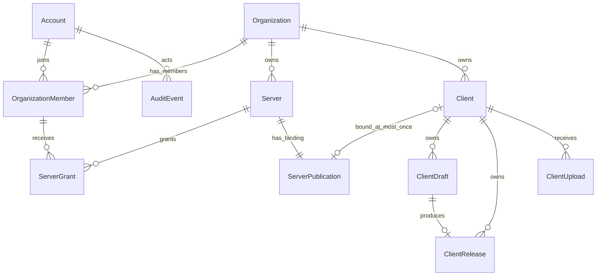

# 最小数据库模型

2026-10-12：Server 新增 displayMode（默认 PERMANENT）、displayStartsAt、displayEndsAt，独立控制目录展示区间，保留 isListed 原有公开分发开关语义。数据库检查 RANGE 起止有效且有序，展示设置仅超管面板会话可写。见 [服务器展示时间](server-display-schedule.md)。

2026-10-12 平台无关修订：新 muapack v2 的 target-manifest 与 mua-pack.json 均使用 protocolRevision:2，不含 supportedPlatforms／platformsChanged，不按平台限制完整包或更新包；环境兼容性由 Launcher 判断。universal 仅是后台任务标识。旧数据库平台列保留历史兼容，新草稿为空；历史非空草稿、清单、READY 字节和签名不改写，旧目标仍按原规则读取。数据库迁移为 202610120004_v2_platform_independent，v1 平台机制保留。此说明优先于下文历史六平台／平台修改描述。

更新：2026-10-10。核心模型及环境下载设置已实现；范围见[实施进度](implementation-status.md)，接口见[客户端上传 API](client-upload-api.md)，权限见[权限矩阵](permission-matrix.md)。

## 关系与约束

Organization 拥有 members、servers 和 clients。Client 是独立版本容器，可以先上传后绑定；一个组织可以有多个客户端。Server 同时至多绑定一个 Client；当前实现也限制 Client 同时至多绑定一个 Server。可在解绑后改绑同组织其他服务器，不支持同时跨服共享或跨组织绑定。

未删除客户端名称在组织内唯一，去首尾空白、NFKC 归一化并忽略大小写；归档名称继续保留，符合条件的删除释放名称。新上传同名客户端返回冲突，必须对原客户端使用更新功能，创建新版本。客户端 ID 独立于 MUA server ID：新记录生成 UUID；旧记录保留原字符串 ID，不重写对象键或历史签名。

客户端当前发布由 Client.currentReleaseId 选择。绑定服务器的 ServerPublication.releaseId 必须同步等于该值。版本和历史跟随客户端身份，服务器绑定只是可变引用；CAS 的字节去重不合并客户端或发布记录。

## 核心表

| 表 | 主要字段与作用 |
| --- | --- |
| Account | UUID、displayName、ACTIVE/DISABLED、isSuperAdmin；白名单账号 |
| Organization | UUID、displayName 别名、avatarObjectKey、description、archivedAt |
| OrganizationMember | organizationId + accountId 复合主键、roles、status；多组织独立授权 |
| Server | serverId 为既有 3–5 位 ASCII 英文字母、organizationId、displayName、description、gameAddress、iconObjectKey、sortOrder、themeColor、isListed、archivedAt |
| ServerGrant | accountId + serverId 复合主键、organizationId、roles；账号必须是本组织成员 |
| Client | 独立 id、organizationId、name、nameKey、scopeServerId、currentReleaseId、revision、待绑定请求、archivedAt |
| ClientDraft | UUID、clientId、版本资料、候选 Manifest、contentRevision、status、审核修订／人／时间／说明、archivedAt |
| ClientRelease | UUID、clientId、sourceDraftId、版本资料及环境快照、Manifest 对象键／摘要、签名／密钥、publishedAt、archivedAt |
| ServerPublication | serverId 主键、clientId 可空且唯一、releaseId 可空、revision、changedById |
| AuditEvent | 操作者、action、targetType/id、organizationId/serverId、details、createdAt；仅追加 |

服务器 ID 大小写无关唯一，但保留原值；不以展示别名识别业务资源。组织与服务器只允许超管登记、归档；服务器创建只初始化空 ServerPublication，不自动创建 Client。

### Client 的身份、授权与绑定请求

| 字段 | 约束 |
| --- | --- |
| id | text 主键，应用生成 UUID；兼容已有 server ID 形式的旧客户端 ID |
| organizationId | UUID 外键，归属固定 |
| name / nameKey | 名称与归一化索引，组织内唯一，当前不开放重命名 |
| scopeServerId | 可空，同组织服务器外键；创建时固定的单服授权来源 |
| currentReleaseId | 可空，复合外键 (id,currentReleaseId) 指向本客户端 Release |
| revision | 非负整数；客户端版本切换并发修订 |
| requestedServerId | 可空，同组织外键；待确认执行的目标服务器 |
| requestedRevision / expectedClientId | 保存用户确认替换时服务器绑定快照；执行前再次校验 |
| archivedAt | 归档保留版本与对象，清除服务器绑定和待绑定请求 |

组织角色覆盖本组织所有客户端。单服角色优先按当前绑定服务器计算；客户端未绑定时按 scopeServerId 计算，没有来源服务器的独立客户端仅接受组织范围授权。组织成员停用使其组织角色与全部单服角色失效。绑定／替换检查客户端、目标服务器及被替换客户端的 CLIENT_BIND；不能靠前端列表过滤替代权限验证。

### 草稿与发布

ClientDraft 增加不可变 versionSequence、同客户端 replacesDraftId、archiveReason 与 supersededByDraftId；ClientUpload 增加同客户端 comparisonDraftId、独立 comparisonStatistics。迁移保留历史签名字节，不推断已有草稿关系。手动归档与发布成功的替代链归档规则见[草稿生命周期](draft-lifecycle.md)。

草稿与发布通过 clientId 关联，不通过 serverId 固定资源身份。ClientDraft 的候选内容在提交后冻结，审核绑定 contentRevision 与 Manifest 摘要；已发布草稿不可修改。ClientRelease 在插入后内容、来源及签名不可变；(clientId,versionLabel) 与 sourceDraftId 唯一，来源草稿和基准版本必须属于同一客户端。

202610100003_package_format_choice 为 ClientUpload／ClientDraft／ClientRelease 增加不可变 packageFormatVersion（数字 1／2，历史默认 1），不改写已有签名文档。上传选择属于候选版本，不属于 Client；数据库检查上传、草稿和发布格式一致。UploadStatus 增加 WAITING_PROCESSOR，曾用于第 2 步暂存；202610100004_v2_recipe_import 开放 v2 QUEUED／PROCESSING／READY，重排有效旧等待任务，仅校验本地 CAS、保存远程／环境声明。202610100005_v2_recipe_packages 开放 v2 SUBMITTED／组包／发布，新增 ClientDraft.supportedPlatforms 和 PackageBuild.revision；唯一键为 (draftId,platform,revision)。v1 保持实际平台／revision=1，v2 使用 universal／当前 packageRevision；平台调整新建修订，不重写已完成对象。发布指向当前审核的 READY 目标清单，数据库检查格式、平台、修订及签名密钥一致。等待和处理任务纳入身份与删除保护；删除仍需先归档、无绑定并取消可取消任务。详见[上传 API](client-upload-api.md)及[v2 顺序](muapack-v2-design.md)。

元数据包括 name、versionLabel、minecraftVersion、javaVersion、mods、summary、Markdown description；提交 name 必须与客户端身份一致。mods 由 Worker 从整合包 mods 文件夹的 JAR 自动识别；提交参数可省略，后端忽略手填列表并使用冻结的检测结果，表格只读。已发布内容变更要求完整 ZIP、新版本号、新审核与发布。旧标签归档后也不释放。

新清单 schemaVersion 2 固定 organizationId / clientId，不含可变服务器身份；目录与服务器路由提供 serverId。旧 v1 字节与签名不变，限制在原服务器使用。专有分发格式已确定为 muapack v1，协议、后台组包和独立签名已接入；Launcher 安装联调与生产公钥信任／密钥部署仍待完成，不能视为 Launcher 已接入。

### ServerPublication

同一服务器只有一行，clientId 唯一限制一个客户端同时最多绑定一个服务器。clientId 为空时 releaseId 必须为空。关联必须同组织且资源未归档，releaseId 只能引用绑定客户端自身未归档的当前发布。延迟约束触发器确保客户端当前版本与绑定服务器在同一事务同步切换。

新的空客户端绑定空服务器可以立即建立关联，未发布前不分发。替换已绑定服务器时必须明确确认；若新客户端还没有当前发布，则保存待绑定请求并继续分发旧客户端。审核、签名、发布后，有 RELEASE_ACTIVATE 与 CLIENT_BIND 的操作者在同一事务完成客户端版本选择和服务器替换。只有切换权限的人员可以先选择客户端当前发布，再由管理员执行绑定。

绑定 revision 与客户端 revision 各自独立。审核期间别人改变服务器绑定时返回 409，不覆盖新绑定；可以取消待绑定请求，再按最新绑定确认。绑定已发布客户端立即使用其当前版本，不重新签名或修改旧 Release。

## 上传、认证与运行扩展

现有共 21 个 Prisma 模型、4 个枚举；除十张核心业务表外：

| 表 | 作用 |
| --- | --- |
| LocalCredential | 唯一白名单用户名、scrypt 密码摘要；独立于游戏玩家认证 |
| Session | 只存 Token 摘要、账号、到期时间；登录轮换及退出撤销 |
| LoginThrottle | 数据库共享登录限流 |
| ClientUpload | clientId、所有者、原始对象、大小、状态、processingPhase、detectedInfo、selectedInstanceId、客户端版本基准、Worker 租约、索引摘要和统计；来源／基准及准备完成的内容不可变 |
| ApiToken | 摘要、有效期、服务器范围及能力范围；每次请求与当前 RBAC 取交集 |
| WorkerHeartbeat | 独立 Worker 真实心跳 |

新增 CasObject（摘要／大小／回收和清理时间）、CasReference（客户端—摘要引用）、RecycleObject（原包／索引回收对象）、PlatformSettings（保留期，默认 7 天）。Client 增加 deletedAt、storageIndexedAt、recycledAt。文件路径和 managed/preserve 策略仍在候选及发布清单中；引用表防止回收误删共享文件。任务在 PostgreSQL 持久化，Redis 后续接入。

## 事务、归档与安全

应用层 RBAC 是当前第一层安全。写操作使用统一事务锁并重新认证；字段白名单、外键、唯一约束、不可变触发器和并发修订各自保护边界。长时间对象传输与 Worker 解析不持有业务写锁，提交结果前再次检查权限、租约及资源状态。

账号／成员停用，授权撤销保留行与审计；组织、服务器、草稿和发布归档。已归档下架且无实际／待服务器绑定、无活动 Worker 任务的客户端可删除，无论是否曾发布，保留不可恢复标记、不可变发布／签名历史和审计，文件由 Worker 回收。客户端 lifecycleStatus 以归档优先，currentReleaseId 仅保留最近版本选择，不代替公开分发的绑定与状态检查。解绑保留当前版本和历史；归档客户端清除绑定，恢复不自动重新分发。归档组织／服务器也清除绑定并下架。归档自身不移动文件；删除与回收见[回收站规则](client-recycle.md)。

审核、签名发布、版本切换、绑定分别检查权限。组织管理员默认管理和绑定本组织资源，不默认获得审核／发布／切换能力。全局排序、颜色、上架和全局审计仅超管。RLS 已实现，以独立受限角色和事务局部身份上下文做第二层行级保护；现有服务端校验继续保留，见[部署说明](postgresql-rls.md)。

迁移 202610090001_independent_clients 保留旧客户端 ID、草稿、Release、上传和签名对象；同组织旧名称重复时增加 ID 后缀以保留所有历史。旧容器的当前发布和授权来源迁移到 Client。

202610090004_muapack_builds 增加 `PackageBuild`：每个草稿／平台唯一、必需标记、状态／阶段／进度、租约／重试、目标清单键与摘要、整包／更新包产物及签名 key ID。`ClientDraft.packageRevision` 独立锁定平台方案，审核记录 reviewedPackageRevision；改变平台使审批失效，旧审核请求返回冲突。发布 API 与数据库触发器要求全部必需产物 READY；完成产物和已发布草稿不可变。删除客户端还要求无活动组包，私有产物随客户端回收，环境缓存独立保留。详见[后台组包](muapack-worker.md)。

202610090005_modrinth_import 为 PlatformSettings 增加远程来源域名列表、白名单开关（默认 false）、CONNECT 代理开关与地址。ClientUpload 增加 DOWNLOADING 阶段，识别／逐文件进度和 optional 存在 sealed detectedInfo，optional 同时进入 OSS 文件索引和不可变发布清单。首次提交前允许唯一 READY 上传确认临时客户端名称，组织内唯一约束不变，触发器保留所有身份／删除保护；已有草稿或发布后名称不可改变。见 [Modrinth 导入](modrinth-import.md)。

202610090006_environment_mirrors 为 PlatformSettings 增加有序 minecraftDownloadSources（默认 bmclapi／ustc／nju）、javaDownloadSources（默认 tuna）、mirrorProxyEnabled（默认 false）和 javaImageType（默认 jre）。数据库限制合法来源、无重复／空元素及 jre／jdk 枚举值；应用层保留超管面板会话检查与配置审计。当前共十份迁移；下载规则及缓存兼容见[环境下载源](environment-download-sources.md)。

## 验证

集成验证涵盖组织／单服隔离、停用撤权、多个客户端、名称归一化冲突、确认替换、解绑保留历史、同组织绑定、禁止同时跨服共享、乐观并发冲突、审核后替换、不可变快照、版本唯一、CAS 复用及危险 ZIP 拦截。Launcher 实际验签和安装仍需联调。
