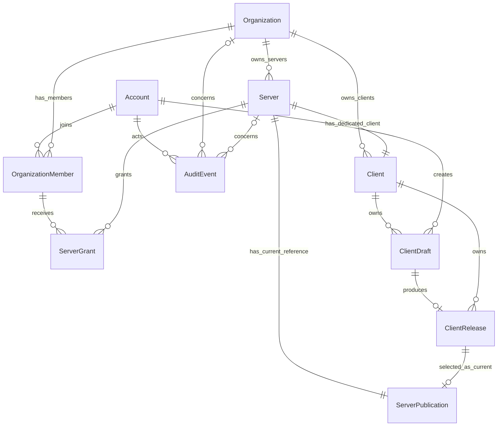

# 最小数据库模型提案

日期：2026-10-08。状态：核心模型已落实到 Prisma schema 并执行迁移；发布流水线仍待实现，具体边界见[实施进度](implementation-status.md)。

依据：[产品需求](mua-backend-requirements.md)；配套：[权限矩阵](permission-matrix.md)。本文确定可评审的表、字段和约束，不冻结 OSS、整合包或 Manifest 协议。

## 1. 范围与已确认选择

建议采用九张业务表：`Account`、`Organization`、`OrganizationMember`、`Server`、`ServerGrant`、`Client`、`ClientDraft`、`ClientRelease`、`ServerPublication`；另设一张最小审计表 `AuditEvent`。

第一阶段已落地账号、组织、成员、服务器、单服务器授权和审计；创建服务器时一并创建专用客户端容器及空的当前发布引用。草稿与发布快照表也已建成，草稿可编辑版本资料，发布写流程尚未开放。新增独立 `LocalCredential`、`Session` 及 `LoginThrottle` 表用于本地白名单认证；暂不增加 CAS 文件表、Worker 队列和对象存储供应商表。

用户已确认：

1. 支持独立的 MUA 审核角色。通过服务器范围的审核权限实现，不要求该账号成为超管。
2. 删除采用归档制度，保留业务记录和历史，不提供面板永久删除操作。
3. 增加组织：组织拥有成员、服务器及客户端，具备内部 ID、头像、简介和别名。组织管理员可以统一管理本组织的多个服务器。
4. 最新决定采用一个服务器对应一个专用客户端，客户端可有多个草稿和历史发布，每台服务器最多一个当前发布；不采用客户端或发布版本跨服务器共享的设计。
5. 权限分两阶段：第一阶段应用层 RBAC 已实现；第二阶段增加 PostgreSQL RLS，作为数据库行级隔离的第二层保护，尚未启用。

第一阶段建议采用预置角色和统一角色—权限映射。组织范围角色保存在 `OrganizationMember.roles`，单服务器角色保存在 `ServerGrant.roles`，不再为每个账号直接保存任意操作权限数组。审核员角色默认只读取和审核，发布人员及版本切换人员角色分别授予；组织范围角色覆盖后续新增服务器，单服角色不会自动扩大。暂不增加动态角色编辑表，后续需要自定义角色时再扩展。

其他约定仍为本提案建议：保留既有 server ID 的原始大小写，使用大小写无关唯一性避免重复登记；第一阶段一个服务器只有一个展示别名；账号身份采用内部 UUID，认证方式之后单独设计。

## 2. 核心关系

`Client` 是某一服务器的专用版本容器，`ClientRelease` 是其一次已审核、已签名的发布快照。客户端容器与服务器一对一，容器与历史版本一对多；当前版本通过 `ServerPublication` 单独选择。版本不能被其他服务器引用，包含同组织的其他服务器。

例如组织别名为 NPU，其下有服务器别名 `NPU RELEASE` 和 `NPU BETA`，各自拥有专用客户端及独立版本历史。一个 NPU 组织管理员无需两次逐服授权即可管理两者，但不能管理其他组织。两服内容相同时可复用 CAS 中的相同哈希对象，不能共用同一条发布记录。

## 3. 字段约定

内部 ID 建议使用 PostgreSQL `uuid`。时间使用 `timestamptz`。业务表默认有 `createdAt`；可变表另有 `updatedAt`。下文 `?` 表示可空，未标记的字段必填。版本标签按字符串保存，不假定 SemVer，也不以标签的字典序确定最新版。

### Account：面板白名单账号

| 字段 | 类型 | 含义与约束 |
| --- | --- | --- |
| `id` | uuid，主键 | 稳定内部账号 ID，未来绑定 YGG 身份不更换此 ID |
| `displayName` | text | 面板显示名称，不作为认证唯一标识 |
| `status` | enum | `ACTIVE` / `DISABLED`，默认 `ACTIVE` |
| `isSuperAdmin` | boolean | 默认 `false`；启用账号才可以使用超管权限 |

`isSuperAdmin` 在最小模型中代表预置全局角色 `SUPER_ADMIN`。其他组织或服务器角色不会提升此字段；后续若增加多种全局角色，再扩展全局角色分配结构。

被超管预先创建的账号记录就是白名单成员；成功认证不自动创建账号。这里不存密码、访问令牌，也不使用玩家昵称作为唯一身份。待选定本地登录方式后，增加相应凭据与会话结构；未来可另设 `AccountIdentity(provider, subject, accountId)` 绑定外部身份。

停用账号时立即失去管理权限；后续登录实现应撤销其会话或在每次管理请求重新校验状态。账号默认不物理删除，以保留发布和审计的操作者引用。初始化第一个超管走明确的本地初始化流程，不开放匿名创建超管的接口。

### Organization：组织

| 字段 | 类型 | 含义与约束 |
| --- | --- | --- |
| `id` | uuid，主键 | 系统生成的内部组织 ID，不以别名或服务器 ID 识别组织 |
| `displayName` | text | 对外别名，例如 NPU，可修改 |
| `description` | text | 组织简介，默认空字符串 |
| `avatarObjectKey` | text? | 组织头像的稳定对象引用 |
| `archivedAt` | timestamptz? | 归档后停止本组织业务写入和 Launcher 分发 |

`members` 通过 `OrganizationMember` 获取；`servers` 和 `clients` 通过各自的 `organizationId` 获取，不把成员或资源 ID 列表存成 JSON。组织别名不承担唯一识别职责。

### OrganizationMember：账号的组织成员身份

| 字段 | 类型 | 含义与约束 |
| --- | --- | --- |
| `organizationId` | uuid，外键 | 指向 `Organization.id` |
| `accountId` | uuid，外键 | 指向已存在的白名单账号 |
| `status` | enum | `ACTIVE` / `DISABLED`，移除成员采用停用并保留记录 |
| `roles` | enum[] | 组织范围预置角色集合，默认空集合；可包含 `ORG_ADMIN`、`REVIEWER` 等，不能包含 `SUPER_ADMIN` |
| `grantedById` | uuid，外键 | 最后调整成员身份或权限的人 |

主键为 `(organizationId, accountId)`。账号可加入多个组织，成员状态与角色在各组织独立。含 `ORG_ADMIN` 的启用成员自动获得该组织全部服务器及专用客户端的基础管理能力，包含后续新增资源；不会获得其他组织的权限。只有成员记录而角色为空时，不自动拥有资源管理权限，但仍可通过单服务器角色获得明确授权。

基础管理能力包括组织资料、已有服务器资料、客户端草稿及历史读取。审核、签名发布和当前版本切换仍需分别授予 `REVIEWER`、`PUBLISHER`、`RELEASE_OPERATOR`，不从 `ORG_ADMIN` 隐含推导。全局服务器排序、颜色、上架、账号白名单和超管管理仍由 MUA 超管控制。组织管理员可管理本组织普通成员及基础角色，但不能授予组织管理员或 MUA 流程角色；这些由超管授予。

组织成员停用后，其组织角色和全部单服务器授权立即失效，不能依靠仍存在的 `ServerGrant` 绕过。具体权限继承和模板见配套矩阵。

### Server：联合服目录和展示配置

| 字段 | 类型 | 含义与约束 |
| --- | --- | --- |
| `serverId` | varchar(5)，主键 | 既有 MUA ID；校验为 3–5 位 ASCII 英文字母 |
| `organizationId` | uuid，外键 | 此服务器唯一所属组织，创建后不提供普通改绑操作 |
| `displayName` | text | 第一阶段的展示别名，可修改 |
| `description` | text | 服务器简介，默认空字符串 |
| `gameAddress` | text? | Minecraft 连接地址；格式在 API 设计时校验 |
| `iconObjectKey` | text? | 图标的稳定对象引用，不保存临时签名 URL |
| `sortOrder` | integer | 默认 `0`；数值较小的排在前面，同值按 server ID 稳定排序 |
| `themeColor` | varchar(7)? | 可选 `#RRGGBB`；空值使用 Launcher 默认主题 |
| `isListed` | boolean | 默认 `false`，由 MUA 控制是否对 Launcher 展示 |
| `archivedAt` | timestamptz? | 归档后隐藏目录项并停止新增草稿或发布 |

server ID 登记后不提供普通编辑操作。大小写规范尚未与既有登记系统核对；建议唯一约束覆盖 `lower(serverId)`，但保留原始 ID 供 Manifest 使用。别名不需要全局唯一，所有管理关联继续用 server ID。

增加唯一键 `(organizationId, serverId)`，用于校验成员授权及客户端归属。组织内部 UUID 与既有 MUA server ID 分开；`NPU RELEASE` / `NPU BETA` 是展示别名，不用含空格的别名代替 3–5 字母 ID。既有登记系统是否为每个实际服务器分配独立 ID 仍需核对，本提案暂沿用原服务器 ID 约定，不自动迁移为组织 ID。

排序、颜色和上架状态与服主可编辑的简介等字段采用不同权限，不能通过通用更新接口绕过。`isListed = true` 不自动发布任何客户端；可安装的公开目录还必须具备有效当前发布引用。

### Client：服务器专用客户端容器

| 字段 | 类型 | 含义与约束 |
| --- | --- | --- |
| `serverId` | varchar(5)，主键及外键 | 与服务器共用稳定标识，强制一服一个客户端容器 |
| `organizationId` | uuid，外键 | 组织直属客户端集合的归属，必须与服务器一致 |
| `archivedAt` | timestamptz? | 归档容器后停止新版本操作及当前客户端分发 |

复合外键 `(organizationId, serverId)` 指向 `Server(organizationId, serverId)`。创建服务器时一并创建客户端容器，客户端不能脱离服务器创建、改绑或被多个服务器共用。名称、简介、环境等发布内容放在草稿和发布快照中，不在容器里再维护一套可原地修改的已发布内容。

容器允许尚无发布版本；这不影响一对一关系。归档客户端时保留容器及所有版本，清空所属服务器的当前引用。恢复不自动重新选择当前版本。

### ServerGrant：账号对指定服务器的操作授权

| 字段 | 类型 | 含义与约束 |
| --- | --- | --- |
| `accountId` | uuid，外键 | 指向 `Account.id` |
| `organizationId` | uuid，外键 | 成员和目标服务器必须属于同一组织 |
| `serverId` | varchar(5)，外键 | 指向 `Server.serverId` |
| `roles` | enum[] | 目标服务器范围的预置角色集合，默认空集合；不能包含 `ORG_ADMIN` 或 `SUPER_ADMIN` |
| `grantedById` | uuid，外键 | 最后调整授权的操作者，需满足对应权限分配规则 |

主键为 `(accountId, serverId)`；复合外键 `(organizationId, accountId)` 指向 `OrganizationMember`，`(organizationId, serverId)` 指向 `Server`。同一账号可获授多个服务器。已获组织范围角色的成员无需逐服复制相同角色；没有相应组织角色时，可通过此表限制到指定服务器。超管不需要创建组织成员或逐服授权记录。

撤销授权清空 `roles` 并保留授权行，同时记录原角色与变更审计；不物理删除授权或业务历史。组织管理员可分配本组织普通成员的基础单服角色；只有超管可授予审核、发布和版本切换角色。普通成员和审核员不能转授权限。

此表采用追加授权语义，不是拒绝列表。删除单服授权不能抵消仍有效的组织管理员或组织范围权限；若要限制到一服，需要降为普通成员并撤销相应组织范围权限。

操作权限枚举作为角色的能力定义，包含服务器资料、草稿管理、历史读取，以及独立的 `DRAFT_REVIEW`、`RELEASE_PUBLISH`、`RELEASE_ACTIVATE`。角色—权限映射统一维护，不能从浏览器传入。审核不自动获得发布或版本切换能力，也不授予排序、颜色、账号管理或归档发布权限。

### ClientDraft：可编辑的客户端候选版本

| 字段 | 类型 | 含义与约束 |
| --- | --- | --- |
| `id` | uuid，主键 | 草稿 ID |
| `serverId` | varchar(5)，外键 | 指向专用 `Client.serverId`，其组织由客户端与服务器关联确定；创建后固定 |
| `versionLabel` | text? | 客户端版本标签，提交审核前必须填写 |
| `name` | text? | 客户端名称，提交前必填 |
| `description` | text | 客户端简介，默认空字符串 |
| `changelog` | text | 此版本更新记录，默认空字符串 |
| `candidateMetadata` | jsonb? | 环境、模组及识别依据等草稿数据；内部格式尚未冻结 |
| `sourceObjectKey` | text? | 原始上传文件的对象引用 |
| `candidateManifestKey` | text? | 归一化候选 Manifest 的不可变对象引用 |
| `candidateManifestSha256` | char(64)? | 候选 Manifest 字节的 SHA-256，小写十六进制 |
| `contentRevision` | integer | 从 `1` 开始；任何内容或文件清单修改都增加修订号 |
| `status` | enum | `DRAFT` / `SUBMITTED` / `APPROVED` / `REJECTED` / `RELEASED` |
| `createdById` | uuid，外键 | 草稿创建者；不等于服务器所有者或永久授权 |
| `reviewedById` | uuid?，外键 | 最近一次审核人 |
| `reviewedRevision` | integer? | 被审核的内容修订号 |
| `reviewedAt` | timestamptz? | 最近审核时间 |
| `reviewNote` | text? | 审核说明，驳回时必须给出原因 |
| `archivedAt` | timestamptz? | 归档草稿，停止编辑或提交 |

允许编辑 `DRAFT` / `REJECTED` 内容；修改被驳回草稿时回到 `DRAFT` 并清除旧审核结论。`SUBMITTED` / `APPROVED` 内容锁定，可撤回到 `DRAFT` 后修改；撤回同时作废审核。`RELEASED` 的源草稿保持冻结，后续变更复制为新草稿。

草稿允许版本标签未填或暂时重复；提交前校验必填字段与冲突，发布时以发布表的唯一约束兜底。归档并不释放已经发布过的版本标签。

为后续来源复合外键增加唯一键 `(serverId, id)`。复制不是修改草稿归属：读取源服内容并在目标授权服创建新草稿，按权限矩阵分别检查两侧授权。

提交时要求已完成导入和识别、候选 Manifest 存在且摘要一致。审批绑定 `contentRevision` 和该 Manifest 摘要；不得审核一份文件、发布另一份文件。Worker 若改变内容，也必须遵循修订号及审核失效规则，不能在审核期间悄悄改草稿。

### ClientRelease：不可变的已发布快照

| 字段 | 类型 | 含义与约束 |
| --- | --- | --- |
| `id` | uuid，主键 | 发布 ID |
| `serverId` | varchar(5)，外键 | 指向专用 `Client.serverId`，此版本只服务于该服务器及其所属组织 |
| `sourceDraftId` | uuid，唯一外键 | 来源草稿；同一草稿最多生成一个发布 |
| `versionLabel` | text | 发布时固定的客户端版本标签 |
| `name` / `description` / `changelog` | text | 固定的发布名称、简介及更新记录 |
| `environmentSnapshot` | jsonb | 固定的运行环境摘要；格式在 Manifest 设计时确定 |
| `manifestObjectKey` | text | 不可变 Release Manifest 的对象引用 |
| `manifestSha256` | char(64) | 固定 Manifest 字节的 SHA-256 |
| `packObjectKey` | text? | 对应完整 MUA 专有包的不可变对象引用 |
| `signingKeyId` | text | 签名公钥标识；不存私钥 |
| `signature` | text | 签名值，编码及算法随签名协议确定 |
| `approvedById` / `publishedById` | uuid，外键 | 审核人、发布人 |
| `publishedAt` | timestamptz | 首次发布时刻，不随当前版本切换而变化 |
| `archivedAt` | timestamptz? | 唯一可变的可用性字段，由管理操作更新 |

唯一约束：`(serverId, versionLabel)`、`sourceDraftId`，另为复合外键提供唯一键 `(serverId, id)`。来源草稿必须属于同一服务器，可通过 `(serverId, sourceDraftId)` 引用草稿的唯一键 `(serverId, id)` 加强约束。

发布内容、关联和签名字段在插入后全部只读。`archivedAt` 只是撤下或恢复可用性的管理标记，不是修改旧版内容；改变已发布简介、文件、环境、策略或绑定服务器都要创建新版本。归档版本保留原 Manifest、对象引用和签名，不能继续成为当前可安装版本。

完整文件和模组清单以不可变 Manifest 为准，第一阶段不在数据库里再维护一套独立的逐文件副本。`environmentSnapshot` 应与 Manifest 一致，后续再定义协议及校验规则。审核通过但签名或对象上传未完成时，不创建可安装的发布记录。

### ServerPublication：服务器的唯一当前版本引用

| 字段 | 类型 | 含义与约束 |
| --- | --- | --- |
| `serverId` | varchar(5)，主键及外键 | 一个服务器最多一行 |
| `releaseId` | uuid? | 当前发布版本；空值表示无当前客户端 |
| `revision` | integer | 从 `0` 开始，每次发布、切换或撤下递增，用于并发冲突检查 |
| `changedById` | uuid，外键 | 最后调整者 |

创建服务器时一并创建空引用行。复合外键 `(serverId, releaseId)` 指向 `ClientRelease(serverId, id)`，让数据库拒绝绑定其他服务器的版本；`serverId` 永不为空，`releaseId` 可以为空。

不要在每个发布版本上增加独立 `isCurrent` 标记。旧版本仍是已发布历史，但不被此表引用就不会作为当前安装版本对 Launcher 展示。

### AuditEvent：最小操作审计

| 字段 | 类型 | 含义与约束 |
| --- | --- | --- |
| `id` | uuid，主键 | 事件 ID |
| `actorId` | uuid，外键 | 已认证操作者；第一阶段不记录匿名管理操作 |
| `organizationId` | uuid?，外键 | 组织级操作的归属，全局账号管理可为空 |
| `serverId` | varchar(5)?，外键 | 全局账号管理操作可为空 |
| `action` | text | 如分配权限、编辑资料、审核、发布、切换、归档 |
| `targetType` / `targetId` | text | 被操作资源类型和稳定标识 |
| `details` | jsonb | 最小变更摘要、修订号或原因；不放密码、令牌、私钥 |
| `createdAt` | timestamptz | 操作时间 |

审计记录只追加，普通管理操作不能修改或删除。它用于业务操作留痕，不替代完整的审核历史模型；后续需要逐轮审核记录时再增加审核事件结构。

涉及服务器的事件必须同时记录其组织 ID，并以 `(organizationId, serverId)` 复合外键保证两者一致；纯组织事件允许服务器为空，全局事件允许两者为空。

## 4. 数据库约束与服务层规则

| 约束 | 数据库保护 | 服务层额外校验 |
| --- | --- | --- |
| 既有 MUA ID | 主键、长度、ASCII 字母 CHECK；建议大小写无关唯一索引 | 与既有登记系统核对，普通编辑不能改 ID |
| 组织拥有成员、服务器和客户端 | 组织外键、成员复合主键、客户端与服务器之间的复合外键 | 不用别名推断归属，不能普通改绑组织 |
| 一服一个客户端容器 | `Client.serverId` 主键及外键 | 创建服务器、容器、空当前引用采用同一事务 |
| 授权属于成员和目标服务器 | 成员与服务器复合外键、授权复合主键 | 账号启用、成员启用、组织及资源状态、继承权限 |
| 一服最多一个当前版本 | `ServerPublication.serverId` 主键 | 当前引用的发布必须未归档 |
| 当前版本不能跨服 | 指向发布的复合外键 | 从真实资源归属解析 server ID，不信任请求自报的归属 |
| 发布不能来自其他服草稿 | 草稿和发布之间的复合外键 | 来源草稿已批准，修订号及摘要一致 |
| 同服发布版本标签不重复 | `(serverId, versionLabel)` 唯一约束 | 标签去除首尾空白；提交及发布时友好提示冲突 |
| 一份草稿只发布一次 | `sourceDraftId` 唯一约束 | 发布重试返回已有结果，不能重复生成版本 |
| 发布内容不可变 | 实施时通过字段保护触发器或数据库权限限制 UPDATE/DELETE | 不提供旧版本内容更新接口；可用性操作单独处理 |
| 审核结论不被旧修订复用 | 同行可约束批准状态的审核字段和修订号 | 候选摘要一致、内容锁定，撤回或修改时审核失效 |
| 历史记录不级联丢失 | 账号、组织、成员、服务器、客户端、草稿、发布相关外键采用 RESTRICT/NO ACTION | 删除仅归档，账号和成员停用，授权撤销保留行；面板不提供永久删除 |

发布新版本建议在同一事务里锁定目标服务器和当前引用，校验账号授权、草稿状态及签名依据，插入发布快照，更新当前引用，冻结来源草稿，写入审计。切换已有发布只更新当前引用及审计，不重新创建快照。涉及草稿的操作还锁定对应草稿，使用一致锁顺序；长时间解析、上传和签名在事务外完成，落库前重新检查修订号、归档状态及授权。失败则保留旧当前版本。

归档当前发布或服务器时，在事务内清空其当前引用并写审计；归档服务器还将 `isListed` 设为 `false`。恢复服务器或版本不自动重新对外发布，需要显式上架或切换。跨行的“当前引用必须未归档”等状态规则不能仅依赖普通 CHECK，应通过统一事务入口保护；后续需要直接数据库写入时再增加对应触发器。

归档不释放 server ID 或已发布版本标签，不删除原始包、Manifest、签名及 CAS 引用；归档服务器的草稿和发布记录继续保留，不级联删除或批量改变子记录状态。所有归档和恢复记录操作者、时间、原因及对象范围。未来的对象存储保留期或垃圾回收需单独设计，不能由面板“删除”直接触发。

归档组织时关闭该组织全部服务器的上架状态与当前引用，成员、服务器、客户端及历史记录继续保留；归档单服务器仅影响其专用客户端的分发，不影响同组织其他服务器。恢复组织或服务器后仍需显式恢复上架或当前引用，不能绕过子资源原有的归档状态。各操作按组织、服务器、客户端和草稿的统一锁顺序执行，并重新检查授权与状态。

可变字段的并发编辑采用 `contentRevision` 或明确的乐观锁条件，避免提交审核后仍被旧编辑请求覆盖。这里是待实现要求，不代表 Prisma schema 本身已经提供这些保护。

PostgreSQL 的复合唯一约束、外键及 CHECK 的跨行限制可参见[官方约束文档](https://www.postgresql.org/docs/current/ddl-constraints.html)；Prisma 的删除行为需显式配置，参见[官方 referential actions 文档](https://www.prisma.io/docs/orm/v7/prisma-schema/data-model/relations/referential-actions)。

## 5. RBAC 与 RLS 两阶段实施边界

第一阶段在服务端统一授权入口实现 RBAC：已认证账号取得有效作用域角色，展开角色权限，再校验目标资源归属及状态。所有查询、列表、统计、原始对象下载和 Worker 提交都使用同一组织/服务器范围规则；不能等到 RLS 实施后才限制租户范围。数据库外键、唯一约束和发布不可变保护仍须独立落实。

第二阶段再设计并迁移 RLS policies。现有 `organizationId`、`serverId` 及成员/角色关系提供隔离依据；草稿、发布可以通过所属客户端和服务器关联求得组织，不要求本轮为所有表冗余增加组织字段。具体策略、运行角色、请求上下文和 Prisma 事务封装届时单独评审及验证。

RLS 的核心目标是对数据库读写再检查行范围；它不替代角色的业务操作权限、字段白名单、发布不可变约束、审核流程、归档或 OSS 授权。阶段二应使用非数据库超级用户、无 `BYPASSRLS`、与迁移/表所有者分离的运行账号，并明确是否需要 `FORCE ROW LEVEL SECURITY`。MUA 的应用超管不等于 PostgreSQL 超级用户。

请求身份上下文来自已验证的服务端会话，在同一数据库事务内设置并执行受保护查询；采用事务局部设置，避免连接池复用污染上下文。缺失或无效身份默认拒绝管理数据访问；组织成员资格本身不能使单服成员读取整个组织。后台任务、MUA 管理和 Launcher 公开分发分别定义明确的访问上下文，不能一律使用绕过 RLS 的账号。

RLS 和事务局部设置的行为参见 [PostgreSQL RLS 文档](https://www.postgresql.org/docs/current/ddl-rowsecurity.html)及 [SET 文档](https://www.postgresql.org/docs/current/sql-set.html)。当前仅使用已配置的开发连接，未启用 RLS，也未创建数据库运行角色或策略。

## 6. 后续扩展及落地验收

后续单独设计 `AccountIdentity`、本地凭据、会话、CAS 对象和文件引用、Worker 任务、完整审核历史、签名密钥登记等结构。本轮不预填无法确定的认证账号，也不把未冻结的模组和文件协议字段拆成业务表。

模型落地时至少验证：跨服绑定被拒绝；同服同标签发布被拒绝；并发发布不会产生两个当前版本；修改已提交内容或复用旧审核被拒绝；发布内容更新被拒绝；归档当前版本后不再向 Launcher 分发；停用账号及撤销授权立即影响管理请求；不存在意外级联删除历史的路径。

组织场景还需验证：NPU 管理员自动覆盖 NPU 正式服、测试服及后续新增服务器；不能管理其他组织；普通成员只获测试服授权时不能操作正式服；同组织也不能将测试服发布绑定正式服；停用成员使角色及全部单服权限失效；归档单服不影响组织其他服务器，归档组织关闭全部子服务器分发。

权限相关验收细节见配套矩阵。文档阶段只检查设计一致性，不运行上述功能测试或创建测试数据。
