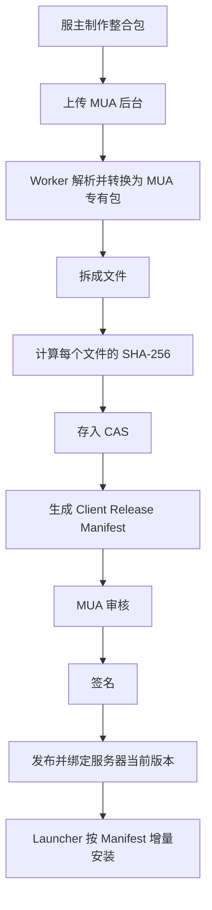

# MUA 定制启动器后端需求记录

更新日期：2026-10-11。

最新上传格式要求已实现：更新窗口默认采用首次发布的 muapack 格式，允许手动改选；超管 Settings 管理“开放的 muapack 格式”，默认 v1／v2 均开放，至少保留一种。关闭格式隐藏新上传／更新选项，标准 API／Actions 创建上传同步拒绝；已创建任务及历史分发保留。规则与接口见[开放格式设置](package-format-settings.md)。

muapack v2 最新确认：保留 v1；添加／更新在实际上传前询问制作 v1 还是 v2。v2 基于 mrpack，MUA 保存并分发 overrides 本地文件，包括本地模组 JAR 和配置；索引声明的远程模组及 Minecraft／Java／加载器由 Launcher 下载、校验和安装，v2 Worker 不下载其二进制。v2 仍有完整发布与增量更新，沿用同一套客户端身份、审核签名、绑定和生命周期。此确认替代“v2 禁止包含任何模组 JAR”的建议；下文远程全量下载／环境组包规则继续用于 v1。第 1–5 步已完成：[协议](muapack-v2.md)、[离线验收样例](examples/muapack-v2/README.md)、上传选择／模型／API、共享识别／导入及完整组包／审核／签名／发布。PCL 私有配置按共享规则过滤；后台生成单一跨平台配方；新 v2 不选择架构，统一声明六个规范目标，历史受限声明／签名保留。固定 releaseId 下载刷新与 v1／v2 分发校验已对齐，见[下载与刷新](launcher-download-api.md)。公开完整包以 acceptedFormatVersions 显式协商，旧端默认只接受 v1。v2 自动增量组包与基准／平台匹配分发已接入；基准是上传时的已发布版本，未发布草稿不能作为玩家基准。无可用基准或跨格式使用 full；旧签名不补写。Launcher 安装尚未接入。详见[上传 API](client-upload-api.md)与[v2 顺序](muapack-v2-design.md)。

最新未发布版本要求已授权：完整上传保持目标快照，未发布草稿的比较与玩家更新基准分开；补齐手动撤回／归档，成功发布仅归档显式替代链的未发布祖先，失败保留旧版本。语义版本判断与内部顺序共同维护，不通过文件名猜测基础包或更新包。实现规则见[草稿生命周期](draft-lifecycle.md)。

最新导入要求：已授权实施 Modrinth mrpack 和 PCL 内包封装，以及 Forge／NeoForge 环境安装。客户端可用的 optional 文件全部进入 CAS 与 muapack，并在文件／模组清单和 Launcher API 保留标记，玩家端选择启用；后台不作 optional 删减。远程来源列表放到超管 Settings，白名单开关默认关闭，代理配置同样仅超管；关闭白名单不关闭 HTTPS、公开地址、重定向和完整性保护。具体实际范围、初次名称确认及仍未完成的 Launcher 联调见 [导入说明](modrinth-import.md) 和 [Forge 环境](forge-environments.md)，此补充覆盖下文把 Modrinth 留到后续的历史描述。

最新环境下载要求已落实：超管在 Settings 选择 BMCLAPI／中科大／南大及清华 Adoptium，国内镜像优先、失败回退官方。镜像是否走代理有独立开关，默认关闭；总代理控制官方环境和 mrpack 下载，MinIO 不走代理。默认集成 JRE，缺少 JRE 明确失败，不能静默换 JDK；超管可明确选择 JDK。大学镜像只用于静态 Maven，Java 精确构建／校验元数据仍来自官方 API。缓存区分 JRE／JDK，不因镜像偏好变化重建，不改写旧签名发布。实际覆盖与复核见[环境下载源](environment-download-sources.md)。

本文整理用户本轮提出的产品需求，并附上对启动器代码的只读观察。它是后续设计和实现的依据，不代表功能已经完成。文中的“设计建议”和“待确定事项”不构成已经批准的数据库模型、API 或文件格式契约。

用户后续已授权开始实现。已落地数据库模型、白名单登录、应用层 RBAC、组织／服务器管理，以及手动 .minecraft ZIP 上传、MinIO、Worker、CAS、版本差异、审核和签名发布；启动器验签与增量安装尚未接入。当前完成范围与接口见[实施进度](implementation-status.md)。

配套文档：[最小数据库模型](minimal-data-model.md)、[权限矩阵](permission-matrix.md)、[客户端上传 API](client-upload-api.md)。客户端管理采用单一表格与上传／更新窗口，更新必须上传完整整合包、使用新版本号并重新审核；审核批准后的发布切换才更新服务器当前绑定。Modrinth／已验证 PCL 封装导入和 muapack 导出已接入，CurseForge／MultiMC 仍留待后续。

用户后续已确认：审核可以另设角色，删除采用归档制度。设计提案据此加入按服务器授权的 MUA 审核员，并保留归档记录和历史，不提供面板永久删除操作。

2026-10-10 最新补充：归档表示客户端从线上下架，并优先于发布状态；已归档且无实际／待绑定服务器、无活动 Worker 任务的客户端均可删除，无论是否曾发布。此规则替代 2026-10-09 的“从未发布才能删除”。删除保留不可恢复标记、不可变发布／签名历史及审计，退出管理列表并释放名称；文件进私有 OSS 回收站，相同文件上传时可取回复用，默认保留 7 天，仅 MUA 超管修改。组织、服务器与发布历史仍保留，归档自身不清理文件。具体实现见[客户端回收站](client-recycle.md)。

最新组织与客户端关系：增加 organization，组织拥有成员、服务器和客户端，提供内部 ID、别名、头像和简介；组织管理员统一管理本组织多个服务器。用户最新要求组织可上传多个独立客户端，服务器同时至多绑定一个客户端；支持绑定／解绑，替换原绑定须提示确认。同组织已有同名客户端时提示使用更新，不允许用新增提交同名新版本。当前按每客户端同时至多绑定一个服务器、组织内名称唯一实现，可解绑后改绑同组织其他服务器，不支持同时跨服共享。版本历史归属于客户端，解绑不删除历史。

权限实施顺序已确定：先实现应用层 RBAC，再增加 PostgreSQL RLS 作为第二层行级安全保护。应用层 RBAC 已实现，RLS 尚未启用。

## 1. 产品定位与项目边界

MUA 高校联盟有多个高校联合服，每个联合服需要一个服务器专用整合包。定制启动器把这些服务器集中显示在同一界面，玩家选择服务器后，下载或更新相应客户端并启动。

组织是高校或运营团队的管理单元。例如 NPU 是组织，NPU RELEASE 与 NPU BETA 是其两个服务器的展示别名，组织下可保留多个独立客户端与各自版本历史，两台服务器各选择一个当前绑定客户端。组织管理员可同时管理两个服务器，而普通成员仍可仅获得测试服权限。

启动器基于 Minecraft Fabric 平台开发，本质上是一个 Minecraft 客户端。源码目录：

```text
G:\Projects\Minecraft\BotWMCS\launcher-template-26.1
```

本仓库承担服务器目录、网页管理面板、客户端导入与版本管理、文件分发及发布管理。Launcher 通过 RESTful API 获取服务器列表，并根据发布 Manifest 增量安装客户端。

后端现有技术基础为 Next.js App Router、TypeScript、Prisma 和 PostgreSQL。开发数据库是本地 Docker 容器 `mualauncher-psql` 提供的 PostgreSQL，连接信息保存在忽略提交的 `.env` 中。本文不复制数据库密码。

### Organization 的确定需求

- 系统维护稳定内部组织 ID，不用可修改的别名区分组织。
- 可设置别名、头像和简介。
- 拥有 members、servers、clients；一个账号可属于多个组织，权限分别管理。
- 服务器和客户端发布挂靠组织；客户端发布通过独立客户端关联到所属组织，服务器绑定不改变客户端归属。
- 组织管理员的基础管理能力覆盖组织现有及后续新增服务器，不能操作其他组织。
- 允许上传多个独立客户端，服务器同时至多绑定一个客户端；客户端保留多个草稿和历史发布，可绑定／解绑。

## 2. 联合服标识与展示

以下为确定需求：

- 沿用 MUA 既有的服务器 ID，每个联合服有一个 **3–5 字符、纯英文字母**的 ID。
- 该 ID 是服务器底层识别符；客户端使用独立 ID，目录及绑定关联两者。新版 Manifest 固定客户端身份，服务器身份由目录及请求路由确定。
- 对外展示采用别名机制，不通过修改底层 ID 来修改展示名称。
- 面板支持联合服的增、删、查、改。
- MUA 管理层可以控制服务器在 Launcher 面板中的位置，例如把活动服务器放在第一位。
- 服务器展示颜色可定义，由 MUA 管理层控制。

待确定：既有 ID 登记系统如何接入、大小写及唯一性规则、别名数量和语言、ID 是否允许迁移。删除采用归档并保留历史；不能以当前启动器里的展示文字推断真实 MUA server ID。

## 3. 网页面板账号与权限

以下为确定需求：

- 面板面向联合服服主和 MUA 管理人员。
- 开发阶段只做白名单账号，不开放自由注册。
- 账号权限按组织、服务器和操作细分：NPU 组织管理员可管理组织的正式服与测试服，单服维护人员仅管理获授权服务器；均不能越权管理其他组织。
- MUA 管理层使用超级管理员账号，可控制全部服务器、客户端及服务器展示排序和颜色。
- 后续视情况接入基于 YGG 皮肤站的联合服认证系统。
- 审核可以由独立的 MUA 审核角色承担，不要求所有审核人员成为超级管理员。
- 第一阶段采用按组织/服务器作用域分配角色的 RBAC，后续以 PostgreSQL RLS 加强数据库行级隔离；两个阶段都保留服务端业务权限校验。

权限设计建议：采用“账号 + 组织成员身份 + 组织范围或单服务器范围 + 操作权限”，不要仅依赖前端隐藏按钮。上传、编辑草稿、提交审核、审核、签名、发布、切换当前版本和归档等动作分别考虑授权，所有管理端请求及异步任务都执行对应检查。

白名单解决“谁可以进入面板”，组织成员和资源授权解决“进入后能操作什么”，两者应独立表达。未来接入认证系统时仍保留组织成员及资源范围授权；游戏玩家登录与面板管理员授权也应分别处理。

待确定：白名单账号的本地登录方式、账号创建和停用流程、多服务器授权方式、服主能否申请创建服务器、各操作的默认权限，以及审核者是否必须与上传者不同。目前“白名单”不等于已确定密码登录、验证码或其他登录协议。

## 4. 客户端与发布版本管理

以下为确定需求：

- 提供类似 Git 的客户端发布和版本管理体验，例如 `v1.0`、`v1.1`。
- 编辑界面至少包含简介、版本管理、绑定服务器几个板块。
- 可以保留多个历史版本；一个服务器同时最多有一个对 Launcher 展示的客户端发布版本。
- 组织可上传多个客户端；同组织名称已存在时必须更新原客户端。每服同时至多绑定一个客户端，解绑后可选择同组织另一个客户端；不同时跨服共享。
- 发布后，服务器与客户端发布版本绑定。
- 修改已经发布的客户端，只能创建并发布新版本，不能直接修改旧版本。

“一个客户端”限制的是服务器同一时间的绑定数量，不限制组织上传和保留的客户端数量。当前也限制每个客户端同时至多绑定一个服务器，名称唯一按组织范围检查。替换已绑定服务器需确认，新上传客户端审核发布并启用前继续使用旧绑定；解绑保留客户端及其历史。

设计建议：把可编辑的导入草稿、不可变的发布快照和服务器的当前发布引用分开。发布快照固定其内容、版本信息、环境、模组列表、文件策略、固定的 client ID 和签名依据；改变这些信息时产生新版本。服务器别名、展示排序和颜色属于服务器展示配置，可单独管理。

切换当前版本时建议原子更新引用，确保 Launcher 不会得到两个当前版本，或新旧版本混合的文件清单。审核和发布失败不应替换当前可用版本。

“类似 Git”目前确定的是版本历史和不可变发布语义，不要求真的保存为 Git 仓库、实现分支合并或二进制差分补丁。删除已确定为归档并保留发布历史；版本号格式、版本对比、父版本关系、回退到历史版本及撤回规则仍待确定。

## 5. 上传格式与自动识别

需要兼容的输入形式：

- MultiMC 整合包。
- CurseForge 整合包。
- Modrinth 整合包。
- 传统 `.minecraft` 压缩文件。

本阶段用户已要求：模组列表使用表格而非文本框，由 mods 文件夹自动识别。当前实现递归列出目标实例 mods 内的 JAR 文件名／路径，兼容根目录与版本隔离目录；列表只读，后台提交以 Worker 结果为准。格式、运行环境与模组识别归入同一适配器体系；目前仅开放 .minecraft ZIP。

用户已批准 .minecraft 元数据自动识别计划，并要求先向前端反馈“正在识别客户端信息”，识别完成后填充 MC／Java，再继续 CAS。当前支持 PCL、HMCL、标准 Mojang 版本 JSON 与继承链，游戏 JAR 内 version.json 用于交叉验证。多实例需选择目标，缺失／冲突提示手动确认；不从实例名猜整合包发布版本。Java 采用包内明确声明及官方版本目录缓存，未知版本不静默默认 Java 21。识别成功不等于已验证加载器／模组运行兼容性，Launcher 联调仍待进行。

用户上传后，系统自动识别格式并尽可能填充客户端版本、所需环境、模组列表等信息。自动识别结果应进入可查看、补充和确认的草稿；缺失信息、冲突信息或无法确定的环境不能被默认为已准确识别。

待设计的识别信息包括整合包名称及版本、Minecraft 版本、加载器类型和版本、Java 要求、模组及其版本、简介、图标、更新日志和许可信息。需要区分“整合包版本”“Minecraft 版本”“加载器版本”及“协议格式版本”。

具体格式变体、支持的加载器范围、外部下载引用的处理方式，以及在传统 `.minecraft` 目录里如何识别目标实例，需要在实现解析器前确定。启动器宿主使用 Fabric，不代表所有被导入客户端的加载器兼容范围已经确定。

设计建议：保留原始上传文件、格式识别依据、解析结果和任务日志；无法自动处理的内容应明确报告。外部文件的下载失败、哈希不符、来源或许可不允许重新分发时，不应无提示地进入已发布状态。

## 6. 导入、归一化与发布流程

用户指定的流程：



归一化后的压缩包用于表达或导出完整整合包；CAS 和 Manifest 用于逐文件分发与增量安装。两者应描述同一份发布内容，不能由两套独立文件清单分别维护。

设计建议：上传、解析、文件归一化、哈希、入库、审核和发布分别记录状态与失败原因。解析、下载或转换属于 Worker 工作，不应依赖一次网页请求持续运行。草稿或任务失败不能自动变成可公开安装的发布。

队列产品、Worker 运行平台、任务重试规则、进度反馈方式和各状态的具体名称尚未确定。

## 7. MUA 专有整合包

2026-10-09 最新分发方案采用 `.muapack v1`，统一承载整包和更新包；更新包记录变化清单。发布页面多选目标平台，默认全选 Windows／Linux／macOS 的 amd64／aarch64 六种组合。Worker 在发布前持续后台组包并保存 OSS，关闭页面不取消任务；客户端管理表格显示进度，必需产物未全部完成时服务端禁止发布。Minecraft、加载器和 Java 使用独立环境 bucket 及校验后的缓存。此方案覆盖此前请求下载时现场组包的主要路径。协议模型、签名及只读 ZIP 校验已实现，见 [muapack v1 协议](muapack-v1.md)；实际 Worker 组包、环境缓存、平台选择／表格进度及发布门槛已接入，见 [实施说明](muapack-worker.md)。

早期同时提到了 `.muac`；当前讨论以 `.muapack` 为分发扩展名，不擅自把二者设计为两个阶段。

可采用 ZIP 压缩容器。用户提出的内部布局为：

```text
NPUcraft-2026.10.1.muapack
├─ mua-pack.json
├─ icon.png
├─ overrides/
│  ├─ config/
│  ├─ resourcepacks/
│  ├─ shaderpacks/
│  └─ ...
├─ files/
│  └─ ...
└─ metadata/
   ├─ changelog.md
   └─ licenses.json
```

上述布局是早期输入参考；当前 v1 使用协议规定的 metadata 和按摘要寻址的 objects 布局。mua-pack.json 绑定组织／客户端／发布身份、平台、完整清单和差异。服务器身份仍采用既有 MUA server ID，由目录及绑定接口表达，不固定到新版不可变客户端包中，以支持同组织解绑后改绑；不支持同时跨服共享。

v1 的字段、必需条目、目标路径、环境引用与签名范围以协议模型为准。生产生成和现有 Release 模型的连接、Launcher 安装和命令执行仍需下一阶段实施与联调。

压缩包目录名称不直接决定文件策略；例如 `config/` 中既可以有强制更新的 `managed` 文件，也可以有保留用户修改的 `preserve` 文件。

## 8. CAS、对象存储和 Manifest

以下为确定需求：

- 客户端文件部署在 OSS 中。
- 开发环境使用 MinIO。
- 生产环境可考虑 AWS、Cloudflare、阿里云等对象存储，尚未选定供应商。
- 按文件计算 SHA-256，并存入内容寻址存储（CAS）。
- 生成 Client Release Manifest，供 Launcher 增量安装。
- 发布流程包含 MUA 审核和签名。

设计建议：PostgreSQL 保存组织、成员、服务器、专用客户端、账号、授权、版本、审核、任务及文件引用等结构化记录；对象存储保存原始上传、归一化包、CAS 文件、头像、图标和 Manifest 等对象。通过存储抽象适配各供应商，不把数据库关系绑定到某个供应商的 URL。

CAS 建议以文件原始字节的 SHA-256 寻址，同一内容可由多个发布引用。哈希决定内容身份，安装路径和文件策略属于发布清单。同一哈希对象不能原地覆盖；删除草稿或历史版本也不能直接删除仍被其他版本引用的对象。

Manifest 的候选信息包括：协议版本、组织内部 ID、server ID、发布 ID、客户端版本、运行环境、各文件的安装路径、大小、SHA-256、策略及稳定对象引用。具体字段、下载地址签发方式、路径规范和协议版本协商尚未确定。

SHA-256 用于校验文件内容，签名用于验证发布来源；二者职责不同。签名算法、签名数据的规范化方式、公钥分发与轮换、撤销策略仍待设计。建议不要把会过期的下载 URL 当成不可变发布内容的身份。

## 9. 文件更新策略

用户确定的两种策略：

| 策略 | 本地不存在 | 本地已存在且哈希一致 | 本地已存在且哈希不一致 |
| --- | --- | --- | --- |
| `managed` | 下载并安装目标文件 | 跳过下载 | 增量下载并替换为目标文件 |
| `preserve` | 可以下载并创建初始文件 | 不覆盖 | 不覆盖 |

`managed` 适用于模组、强制性配置等必须与发布版本一致的文件。`preserve` 用于提供首次安装默认值、同时保留用户后续修改的文件。

`preserve` 判断的是文件是否存在，不以旧文件哈希是否匹配来决定覆盖。发布新版本后，即使默认内容发生变化，已有的 `preserve` 文件也不应被更新机制覆盖。

增量单位目前是文件：Launcher 比较目标 Manifest 和本地文件后，仅获取需要的对象。二进制差分补丁不属于本轮已确定需求。

待确定事项包括：新版本清单移除的旧 `managed` 文件如何清理、文件策略从 `managed` 切换到 `preserve` 或反向切换时如何处理、首次下载文件的校验与原子落盘、安装中断恢复及回退时的用户文件保留规则。不能把清理整个实例目录作为默认更新行为。

## 10. Launcher REST API 的目标

Launcher 需要获得服务器列表及其展示信息，并定位所选服务器的唯一当前发布 Manifest。

建议对 Launcher 提供的服务器目录包含组织内部 ID 及组织展示信息、server ID、服务器别名、展示顺序、颜色及当前发布引用；历史版本、草稿、审核信息和面板管理数据单独提供对应权限的访问方式。

只有已经完成审核、签名和发布的版本进入安装流程。Launcher 获取 Manifest 后校验签名，按文件策略比较和下载，校验文件 SHA-256，完成安装再启动目标 Minecraft 实例。

第一阶段已提供公开目录基础 `GET /api/v1/servers`，仅返回有可用当前发布且已上架的服务器；管理端点和错误约定见[实施进度](implementation-status.md)。Manifest 协议、分页和缓存、下载授权及是否显示尚无客户端的服务器仍需后续确定；当前接口不是完整的安装协议。

## 11. 启动器现状：本轮源码观察

以下内容来自 2026-10-08 对本地源码的只读检查，表示当前代码状态，不是后端已经实现的功能：

- [`fabric.mod.json`](../../launcher-template-26.1/src/main/resources/fabric.mod.json) 声明 Fabric 客户端入口，当前宿主目标为 Minecraft `~26.1`、Java `>=25`。
- [`LauncherScreen.java`](../../launcher-template-26.1/src/client/java/link/botwmcs/launcher/client/screen/LauncherScreen.java) 的服务器选项仍是写死的展示文字，包含 MUA 联合服、华侨大学服务器、NPUcraft、魂兮归来；没有对应的后端 server ID 绑定。启动按钮仍为 TODO，选择回调只更新展示文字。
- [`GameLauncher.java`](../../launcher-template-26.1/src/client/java/link/botwmcs/launcher/util/GameLauncher.java) 已提供构造启动参数和创建子进程的工具，支持显式指定目标安装根目录，默认根目录是宿主游戏目录下的 `.minecraft`。这不等于 UI 已接入完整下载和启动流程。
- [`game-launcher.md`](../../launcher-template-26.1/docs/game-launcher.md) 及启动工具说明目标版本 JSON/JAR、libraries、assets、natives 等需要预先准备；未合并父版本的 `inheritsFrom` 元数据会被拒绝。现有工具不承担完整的下载、整合包安装或 Manifest 更新。
- [`LauncherConfig.java`](../../launcher-template-26.1/src/main/java/link/botwmcs/launcher/config/LauncherConfig.java) 目前持久化自动更新和遥测选项，没有服务器目录或发布版本配置。
- 在本次检查的 `src/` 和 `docs/` 中没有发现后端 REST 服务器列表、MUA Manifest、CAS 安装器或面板认证的实现。

因此，后续联调还需要完成 Launcher 的 REST 接入、稳定 server ID 选择、Manifest 验签、按策略增量安装、环境准备和安装后的启动衔接。本轮没有构建或启动游戏，也没有验证真实客户端安装。

## 12. 实现前的设计建议与待确定事项

除前述待定项外，后续实施时建议明确以下规则：

- 归档组织、服务器、专用客户端及版本与原始包、CAS 对象之间的保留和引用关系；面板归档不直接删除对象，对象存储保留期另行设计。
- 审核、签名、发布、排序调整等管理动作的审计记录。
- 上传大小、解压后大小、文件数量和 Worker 资源限制；解压路径逃逸、链接文件、重复目标路径及外部下载目标的处理。
- 传统 `.minecraft` 包中账号凭据、个人设置、日志、存档和服务端专用文件的筛选规则，避免无意作为客户端公共内容发布。
- 原版 Minecraft 文件、Java、加载器及库由 Launcher 自行准备还是纳入发布依赖引用。
- 发布失败、对象上传失败、并发发布、版本回退和离线安装时的行为。

这些属于后续设计工作，没有在本轮选定实现方式或新增功能范围。

后续设计可先围绕服务器和权限、不可变发布与当前引用、整合包/Manifest/CAS 协议三个部分形成可评审方案，再进入面板、Worker 和 Launcher 联调；具体实现顺序以用户后续要求为准。
