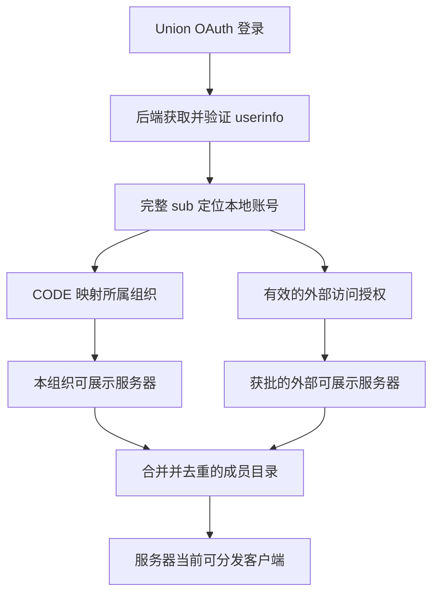

# Union OAuth 登录、成员目录与跨组织访问实施方案

日期：2026-10-21。状态：待实施。

本文整理本轮已确认的产品规则，并给出实现原理、实施顺序和验收要求。编写本文不代表相关功能已经实现，也不授权自动执行数据库迁移、部署或修改启动器。后续可逐阶段实施，每阶段完成后记录实际验证结果。

文中的产品规则按本轮讨论执行；表名、模块名、路由和内部字段是建议设计，落地时可以调整，但不得改变授权边界。未获得上游文档或实测确认的 OAuth 行为明确列为前置核验项。

## 1. 目标与范围

### 1.1 已确认的产品规则

1. 使用 MUA Union OAuth 登录 Union Link。只按账号来源皮肤站分配组织，不识别用户实际高校。
2. `MUA:123` 自动成为 MUA 组织的普通成员；`NPU:456` 自动成为 NPU 皮肤站对应组织的普通成员。
3. 普通成员默认浏览本组织满足展示条件的全部服务器，以及这些服务器当前绑定并启用的已发布客户端，不获得后台管理权限。
4. 普通成员默认不能浏览其他组织资源。其所属组织管理员可以代其申请访问目标组织的部分服务器。
5. 目标组织管理员批准后，该成员的目录增加获批服务器及其当前可分发客户端；成员所属组织不改变，也不因此成为目标组织成员。
6. 服务器选择使用逐项勾选和“全选”按钮。“全选”只影响当前列表，另设“是否自动加入新增的服务器到列表”复选框。
7. 自动加入选项需要随申请一起审批；勾选后，后续新增且满足展示条件的服务器自动进入该成员的可访问范围。
8. 普通成员和外部组织管理员无权查看未发布资源。对外申请界面也不能泄露未发布服务器、客户端、草稿或审核信息。
9. Launcher 资源接口必须先登录，再按账号实时权限返回数据。当前尚在开发阶段，直接修改现有 API，无需保留旧匿名读取行为或兼容旧调用方。
10. 组织管理、上传、编辑、审核、发布、切换、全局管理仍沿用独立授权。MUA 组织管理员不等于系统全局超管。

### 1.2 本期不做的事情

- 不按邮箱域名、学籍、角色绑定或实际高校重新分配组织。
- 不实现跨皮肤站账号自动合并；不同完整 `sub` 默认对应不同本地账号。
- 不把联合认证游戏角色绑定当作 Union Link 账号绑定或跨组织授权。
- 不把成员资源访问授权当作 Minecraft 服务器入服白名单；游戏登录与服务器准入仍由各服处理。
- 不改变 muapack v1/v2 字节、签名域、历史发布、CAS 复用和组包语义。
- 不以这次接入为由删除、重建旧数据库或丢弃已存在的本地管理员账号。

## 2. 已核查的现状与外部依据

### 2.1 MUA Union OAuth 能提供什么

根据 [Union OAuth 文档](https://docs.mualliance.cn/zh/dev/union/oauth)：

| 项目 | 文档内容 |
| --- | --- |
| 协议 | OAuth2 授权码模式，不兼容 OIDC |
| 授权地址 | `https://skin.mualliance.ltd/api/union/oauth2/authorize` |
| 换取令牌 | `https://skin.mualliance.ltd/api/union/oauth2/token` |
| 用户信息 | `https://skin.mualliance.ltd/api/union/oauth2/user` |
| `sub` | `CODE:ID`；来源皮肤站代码与该站用户编号 |
| `nickname` | 皮肤站昵称，不一定是游戏角色名 |
| `email` | 皮肤站注册邮箱；不同站点账号的邮箱可能相同 |
| 接入申请 | 向文档联系人申请 Client ID、Client Secret，登记 redirect_uri |

`sub` 可以确定登录账号的来源皮肤站，但没有提供组织管理员或负责人身份。不能配置成 OIDC 提供方并依赖 ID Token、OIDC discovery 或游戏角色 UUID 完成身份识别。

根据 [联合认证文档](https://docs.mualliance.cn/dev/union/auth)，公开的 [联盟站点 API](https://skin.mualliance.ltd/api/union) 返回 `servers` 列表，条目含 `code`、`bs_root`。这是皮肤站列表，不是 Union Link 的组织、游戏服务器、负责人或权限列表。

本轮浏览器核查中发现响应内存在相同代码对应不同地址的条目，因此不能按返回行直接自动创建正式组织，也不能用地址变化自动迁移账号归属。接入名单和可用性会变化，实施时应重新读取并核对。

### 2.2 当前项目的真实行为

| 现状 | 代码依据 | 对本方案的影响 |
| --- | --- | --- |
| Account 与 LocalCredential 分离，密码关联可空 | [schema.prisma](../prisma/schema.prisma) | 可增加 OAuth 身份，不必为普通成员创建随机本地密码 |
| 本地白名单登录、Cookie Session、账号停用已存在 | [auth.ts](../src/lib/auth.ts) | 复用本地会话与停用边界，增加外部身份认证入口 |
| OrganizationMember 与后台角色、单服授权已存在 | [rbac.ts](../src/lib/rbac.ts)、[roles.ts](../src/lib/roles.ts) | 保留管理 RBAC，增加独立成员读取策略 |
| READ_ONLY 含 SERVER_READ、DRAFT_READ、RELEASE_READ | [roles.ts](../src/lib/roles.ts) | 不可把它默认发给所有 OAuth 用户 |
| 未绑定客户端可以审核、发布，也可启用当前版本 | [publishClient / setCurrentRelease](../src/lib/client-service.ts) | “未绑定＝草稿”不成立；保留后台能力，成员目录不展示未绑定客户端 |
| 解绑保留客户端当前版本与历史 | [unbindClient](../src/lib/client-service.ts) | 已发布但解绑的客户端不能继续凭旧服务器授权分发 |
| 现有服务器目录与下载链路可匿名读取 | [public-database.ts](../src/lib/public-database.ts)、[servers route](../src/app/api/v1/servers/route.ts) | 必须改完整链路，不能只在网页过滤列表 |
| 已有 FORCE RLS、分离运行连接与权限投影 | [postgresql-rls.md](postgresql-rls.md) | 新表、新会话、新投影必须纳入数据库权限与启动检查 |

以上是代码和数据库约束的只读核查结果，不代表本轮实际执行过发布或完整 OAuth 登录测试。

## 3. 核心实现原理

### 3.1 三种关系分别表达

| 关系 | 解决的问题 | 本期规则 |
| --- | --- | --- |
| 外部身份 | 用户以哪个皮肤站账号登录 | 固定 Union 提供方＋完整 `sub` 唯一 |
| 所属组织 | 普通成员默认属于哪个组织 | 从可信 userinfo 的 `sub` 提取 CODE，经超管确认的映射查找组织 |
| 额外访问授权 | 用户还可以浏览哪些外部资源 | 源组织管理员申请，资源所属组织管理员批准 |

组织归属决定默认成员目录；外部访问只增加读取范围，不新增目标组织成员关系，不给目标组织后台角色，也不能转授权。



### 3.2 两层权限，不复用后台只读角色

成员读取层建议定义独立的概念权限：成员目录浏览、服务器详情、当前已发布客户端信息及按既有分发规则下载。下载仍检查产物与版本条件，不等于读取任意后台 Release 或草稿。

管理层继续使用 `ORG_ADMIN`、`SERVER_ADMIN`、`REVIEWER`、`PUBLISHER` 等既有角色。新 OAuth 账号的 `roles=[]`、`isSuperAdmin=false`；成员读取由所属组织及有效访问授权计算，不能靠自动发放 `READ_ONLY` 实现。

后台管理接口、成员接口各自检查权限。某人即使同时是管理员，使用成员目录时也按成员目录规则返回；进入本组织后台后才按管理权限读取草稿。普通成员不能因拿到网页登录 Cookie 就读取完整后台状态、内部 OpenAPI、账号目录或 Settings。

### 3.3 展示条件与分发条件分别保留

服务器目前没有独立“发布”状态。本方案不新增一个与现有上架、发布、绑定并行且容易漂移的发布开关。

建议统一定义：

```text
可分发(server) =
  组织未归档
  且服务器未归档、已上架
  且绑定客户端未归档、未删除
  且当前绑定 release 有效、未归档
  且满足既有产物、平台、格式等分发校验

可展示(server, now) = 可分发所需的有效业务状态
  且处于永久展示或有效展示时间窗口

拥有访问范围(account, server) =
  有效所属组织为服务器组织
  或存在针对该成员且覆盖该服务器的有效外部授权

成员目录可见 = 账号与成员有效 且 可展示 且 拥有访问范围
成员下载可用 = 账号与成员有效 且 可分发 且 拥有访问范围
```

目录的可展示状态不要求遍历并检查所有平台 OSS 对象；签发实际下载链接时仍执行现有大小、摘要、格式、基准与产物校验。

注意：既有展示时间只影响目录，不自动下架或阻止已有服务器的下载和刷新。此次增加账号授权检查，不顺带改变这一规则。未上架、无有效绑定／发布的资源则不能通过直接猜 ID 访问。

### 3.4 成员侧以服务器为访问单位

普通成员只接触服务器当前绑定的可分发客户端，不展示独立未绑定客户端，也不展示草稿、候选版本、待审核上传、组包错误或后台历史详情。

跨组织申请只选择服务器，不再额外维护一套可漂移的独立客户端勾选列表。服务器后续切换当前已发布版本或换绑另一个符合条件的客户端时，成员看到新的当前客户端；旧绑定解除后不能继续凭该服务器授权下载旧客户端。

保留现有“当前绑定客户端的固定历史 release 刷新”能力，但每次都检查当前服务器授权与当前客户端身份；不把历史版本目录或草稿信息开放给普通成员。已经签发的短期存储链接仍受第 8 节的有效期边界约束。

## 4. OAuth 登录与自动入组

### 4.1 皮肤站映射

- 超管维护 `Union CODE -> Organization UUID` 映射，`MUA` 明确指向 MUA 组织。
- 一个 CODE 同时只能有一个有效组织映射；同组织可以按实际需要映射多个经人工确认的 CODE。
- CODE 不复用游戏服务器 ID 的 3–5 位约束。上游文档允许最多 6 位大写字母；最终校验规则在联调中核实，不能简单套用本地 Server ID 校验。
- 普通用户提交的站点、组织 ID、邮箱、昵称都不作为归属依据。只能使用后端从固定 Union userinfo 地址获取的 `sub`。
- 未映射、映射停用或组织归档时，不自动创建组织、不分配到 MUA 兜底；展示明确的“尚未开放接入／请联系管理员”状态，不签发可用成员访问会话。
- 同步站点名单只更新候选资料和可用性提示，不自动删除映射或改变既有账号归属。重新映射是影响既有身份的管理变更，必须有显式迁移与审计，不能随下一次登录静默转组。

### 4.2 身份唯一性与首次登录

外部身份唯一键使用 `(provider, subject)`，provider 固定为本次 Union OAuth 服务，subject 保存完整 `sub`。保留内部 Account UUID，不能把皮肤站数字编号直接作为本地账号主键。

首次成功登录，在一个短事务中完成身份查找／创建、普通账号创建、所属组织成员创建、会话签发和审计。唯一约束与并发重试保证两个同时回调不会生成重复账号。

不按相同邮箱或昵称合并本地账号；不给自动账号创建 LocalCredential。已有本地管理员继续本地登录；若以后接入已有账号绑定，应另行实现双方身份验证，不能让 OAuth 同名用户接管管理员账号。

重复登录只更新允许同步的展示信息和登录时间，不覆盖管理角色、不重置停用、不恢复被撤销的成员关系、不自动恢复外部授权。需要区分“从未入组”与“已被管理员停用／撤销”。本地角色、成员状态和账号状态优先于上游登录成功。

自动入组属于对原“仅本地白名单创建账号”规则的明确扩展，但只允许已启用映射的 Union 来源；后台管理准入不因此对全部成员开放。

### 4.3 浏览器授权码流程

1. 后端生成高熵、短期、一次性 `state`，创建 OAuth 登录事务，绑定发起浏览器与允许的回跳路径。
2. 跳转到固定 Union 授权地址；redirect_uri 使用配置的固定地址，不能接受任意请求参数覆盖。
3. 回调处理拒绝错误、缺失、过期、重放或浏览器关联不匹配的 state。
4. 后端使用 Client Secret 换取令牌，再请求固定 userinfo。外部 HTTP 请求在数据库事务外完成，设置超时和大小限制。
5. 验证实际授权结果和 userinfo 格式，再执行短事务自动入组并签发本地会话。轮换旧会话，清理一次性事务。
6. 错误页面使用统一错误码和本地化文案，不输出授权码、令牌、Client Secret 或原始敏感响应。

当前管理 Cookie 为 `SameSite=Strict`，跨站 OAuth 回调不能假设它一定随请求发送。应为 OAuth 事务设计独立的浏览器关联 Cookie，顶层 GET 回调通常采用短期 `HttpOnly; Secure; SameSite=Lax` Cookie；实际回调方法先核实。不得为了 OAuth 全局放宽管理写请求的同源检查。

新 Cookie 和会话读写遵循已安装 Next.js 文档，使用异步 `cookies()`，在 Route Handler／Server Function 设置响应 Cookie；实现前重新阅读 `node_modules/next/dist/docs/` 中相关指南。

### 4.4 实施前必须核实的上游契约

| 项目 | 当前边界 | 实施动作 |
| --- | --- | --- |
| 应用凭据、回调地址 | 尚未完成本项目申请／配置 | 向上游申请，开发与部署环境分别登记并安全保存 |
| scope、令牌提交方式、错误响应 | 本轮文档未给完整细节 | 使用测试应用核实，固化请求及响应契约 |
| PKCE | 支持情况未确认 | 支持则使用 S256；不支持时由保密后端持有 Secret，不把 Secret 放进 Launcher |
| 有效期、刷新、撤销 | 未确认 | 首版只用上游令牌读取身份；本地会话控制资源访问，不假设上游有刷新／退出回调 |
| CODE、用户编号的稳定性和重用 | 需确认长期身份语义 | 核实迁移／代码重用／删号后的 ID 语义，异常映射冻结处理 |
| Union 站点的 OAuth 可用情况 | 接入联合认证不保证当前 OAuth 可用 | 用真实来源站点验证，失败时不伪造或降级身份 |

上游停用后是否能实时通知本系统尚未确认。本地停用必须即时生效；上游状态变化若仅能在下次 OAuth 验证时发现，应明确记录会话有效期内的限制，不能宣称上游撤销实时同步。

## 5. 跨组织申请与授权

### 5.1 权限主体与流程

以 `MUA:123` 请求 NPU 资源为例：

1. `MUA:Admin` 在 MUA 成员管理中选择本组织有效成员 `MUA:123`。
2. 选择目标 NPU 组织，只展示 NPU 当前满足成员展示条件的服务器及必要的当前客户端摘要。
3. 勾选服务器、填写理由、选择是否自动加入新增服务器，提交申请。
4. `NPU:Admin` 在“收到的访问申请”中查看申请组织、申请人、受益成员、准确的服务器清单、自动加入选项和理由。
5. NPU 管理员同意或拒绝。同意必须对应自己当前看到的申请 revision，事务内重新检查资源归属与申请有效性。
6. 批准后生成独立的有效访问授权；`MUA:123` 的成员目录合并获批 NPU 服务器。

这里“登录审批”分为登录身份验证与跨组织资源审批，不增加“每次正常登录都必须管理员人工同意”的流程。

### 5.2 双方权限边界

| 动作 | 可以执行的主体 |
| --- | --- |
| 为成员发起申请、取消待处理申请 | 成员所属源组织的有效 ORG_ADMIN |
| 查询本组织成员的申请与授权 | 源组织有效 ORG_ADMIN |
| 查看收到的申请、批准、拒绝 | 资源所属目标组织的有效 ORG_ADMIN |
| 撤销已批准授权 | 目标组织管理员，或源组织管理员主动取消访问安排 |
| 浏览获批资源 | 申请指定的有效成员本人 |
| 全局处理异常 | 系统超管，显式操作并记录审计；不让 MUA 普通组织管理员继承此能力 |

普通成员不能修改受益人、冒充管理员提交申请或再转授资源。自动化上传 ApiToken 和 Launcher Token 不能申请、审批或修改授权；审批使用具备相应管理身份的 Cookie 会话。

发起申请的能力仅提供目标组织与可申请资源的受限投影，不把申请者临时变成 NPU 成员。目标组织审批者能查看必要的申请身份摘要，但不能读取 MUA 的完整成员目录或私人信息。

### 5.3 状态、修订与失效

申请建议状态：`PENDING -> APPROVED / REJECTED / CANCELLED`。批准后原申请成为不可改的审批事实；实际授权单独记录 `ACTIVE / REVOKED`。账号停用、成员停用或组织归档导致授权当前不可用，不通过删除记录表示。

- 申请至少包含一个当前可申请服务器；禁止以空清单建立只覆盖未来资源的宽泛申请。
- `PENDING` 期间修改服务器范围或自动加入选项必须增加 revision，旧审批页面返回 409，不允许审批旧快照。
- 审批前重新验证源成员、双方组织、所选资源归属与当前可申请状态；资源已下架／归档／变化时返回冲突并刷新，不能静默缩减后代替审批者同意。
- 授权扩大、追加既有服务器、将自动加入从否改为是，都要新申请或新修订重新审批；原有效授权可继续使用直到替代批准。
- 一方撤销后立即停止后续 API 授权。再次登录或再次上架不自动恢复已撤销记录。
- 单纯审批管理员换届不追溯撤销已批准事实；执行新审批／撤销操作时检查当前管理员权限。
- 不在日志、列表总数、搜索建议或错误响应泄露第三方未发布资源。无权读取的资源返回统一 404；未登录返回 401；可识别但无权执行的管理动作返回 403。

## 6. 勾选、全选与新增服务器

### 6.1 前端行为

- 服务器列表使用现有 TanStack Table、复选框和“全选／取消全选”。
- 全选保存申请时明确选中的服务器 ID 集合，不保存 `ALL` 魔法值；分页／搜索时应标清“本页全选”与“全部可申请服务器全选”，提交前显示准确数量与清单。
- 另有独立选项：“是否自动加入新增的服务器到列表”，默认不选中。
- 审批页逐项展示申请范围。拒绝或批准前可填写说明，不允许审批按钮隐式扩大到全组织。

| 批准范围 | 后续 C 首次满足展示条件时 |
| --- | --- |
| 已选 A、B；自动加入未勾选 | C 不可见 |
| 已选 A、B；自动加入已勾选 | C 自动进入范围 |
| 已选 A；B 已经可展示但未选；自动加入已勾选 | B 保持不可见，后续新增 C 可见 |

### 6.2 “新增”的精确定义

采用本轮讨论的口径：“新增”指目标组织中，在授权生效之后第一次满足成员展示条件的服务器，不仅指数据库新建 Server 行。

- 批准前已经可展示但未勾选的 B，不得因重新上架、更新客户端或改变展示时间而被当成新增。
- 批准时尚未发布的 C，之后首次具备有效发布／绑定并进入展示条件时，属于新增。
- 新服务器仍未发布、未上架或未到展示窗口时，不能提前出现在成员目录。
- 已获得范围的服务器暂时下架或窗口结束时隐藏，恢复后继续按原有效范围判断；不改变其首次可展示事实。
- 新增判定按批准生效时刻建立基线；申请发出到批准之前新增的服务器不自动混入本次清单。批准者需刷新或修改清单才能一并批准这些资源。

建议保存组织内单调递增的“首次可展示序号”，每台服务器仅登记一次；批准时记录目标组织当前序号作为 cutoff，并保留显式选中的服务器集合。

```text
外部授权覆盖服务器 =
  serverId 在批准的显式集合中
  或（autoIncludeNewServers=true
      且 server 的首次可展示序号 > 批准时 cutoff）
```

首次登记、序号分配、批准快照必须使用统一事务／锁顺序，避免并发发布与批准漏记或错记。时间驱动的展示窗口开始也会产生首次可展示事实，应纳入调度与补偿：批准前先补齐截至该时刻已到期的窗口事件，不能依赖“第一次有人查询目录”才登记，否则既有未选资源会被错误纳入未来授权。补偿过程须幂等，只登记首次事实，不给 Worker 增加审批或发布能力。

上线前为既有服务器回填基线。已曾可展示的服务器保留首次事实，即使当前隐藏；无法可靠恢复历史的记录先人工核对或保守标为既有，不把迁移补记误认为未来新增。当前确未发布的资源可在后续首次展示时登记。回填策略与样本结果是阶段验收的一部分。

## 7. 建议的数据模型与模块边界

### 7.1 数据模型草案

以下名称供实现参考，最终迁移应使用仓库当前 Prisma 与 SQL 约定。

| 模型／扩展 | 关键内容 | 约束 |
| --- | --- | --- |
| UnionSkinSiteMapping | code、organizationId、bsRoot、enabled、revision、确认人和时间 | 有效 CODE 唯一；地址是资料，不替代身份键 |
| ExternalIdentity | provider、subject、siteCode、accountId、来源映射、最后登录时间 | provider＋subject 唯一；不存上游明文密码 |
| 成员来源信息 | OAuth 自动入组来源、原映射、创建方式、人工停用标记 | 自动同步不能覆盖管理角色或人工停用；保留已有人工成员 |
| OAuthLoginAttempt | state 摘要、浏览器关联、固定回跳目标、有效期、消费状态 | 一次性、短期、限流；清理过期事务 |
| OrganizationAccessRequest | sourceOrganizationId、targetOrganizationId、beneficiaryAccountId、申请人、理由、autoIncludeNewServers、status、revision、审批人／时间 | 双方组织不同，受益人为源组织有效成员 |
| AccessRequestServer | requestId、serverId | 集合去重，服务器属于目标组织 |
| OrganizationAccessGrant | 已批准 request/revision、受益成员及源成员关系、目标组织、autoIncludeNewServers、cutoff、状态、撤销人／原因 | 只从有效审批生成，批准范围不可原地扩大 |
| AccessGrantServer | grantId、serverId | 固定服务器集合，保留审计与撤销历史 |
| 组织／服务器首次展示记录 | 组织序号、服务器首次序号、时间及来源 | 每台服务器一次，事件幂等，回填与批准串行化 |
| LauncherLoginAttempt / LauncherSession | 本地登录关联、领取凭证、Token 摘要、账号、有效期、撤销状态 | 与管理 ApiToken 分域；不能用于后台写入 |

`OrganizationMember.grantedById` 当前必填且指向真实 Account。自动入组不能伪造管理员、使用新成员自授管理权或随意填一个超管 ID。建议扩展成员创建来源，允许仅 OAuth 自动入组场景使用明确的系统来源和空人工授权人，数据库 CHECK 保证自动来源只能创建普通成员；人工授权仍保留真实操作人。审计同时记录来源站点、映射版本和自动入组原因，不凭空创建可登录的“系统超管”。

每张新业务表都要有唯一约束、外键、必要索引、ENABLE/FORCE RLS 和受限 GRANT。申请列表按源／目标组织、状态、时间分页；授权查询按受益成员、目标组织、状态索引，避免目录逐台 N+1 查询。

### 7.2 建议模块

| 模块 | 职责 |
| --- | --- |
| union-oauth | 固定上游请求、state、userinfo 校验、外部身份登录 |
| member-access | 所属组织、服务器范围、外部授权、有效状态的统一判断 |
| organization-access | 申请／审批／撤销／revision 与审计 |
| member-catalog | 面向成员的服务器与当前客户端投影 |
| launcher-auth | 原生 Launcher 登录关联、本地只读会话与撤销 |
| 数据库安全函数与策略 | 对应成员投影、受限自动入组、申请与授权的行级边界 |

复用签名分发、OSS 校验与现有下载解析器；不再增加一套不校验内容身份的下载实现。新增代码前阅读当前 Next.js 本地指南，不根据旧版本习惯实现路由、Cookie、缓存或重定向。

## 8. Launcher 身份与完整读取链路

### 8.1 浏览器与原生 Launcher 分开承载会话

网页成员入口可使用 HttpOnly Cookie；原生 Launcher 使用专用的本地不透明 Bearer Token，数据库只存摘要。不得把 Union Client Secret、管理 Cookie、上游 OAuth Token 或现有管理 ApiToken 当作 Launcher 的通用登录凭据。

建议原生流程：Launcher 生成领取 verifier 和 challenge，后端创建短期登录尝试；Launcher 打开本系统浏览器登录地址，系统完成 Union OAuth 并绑定该次尝试；Launcher 以 attempt ID＋verifier 在固定后端领取一次性结果，得到本地 Launcher Token。浏览器 URL 中不放长期 Token，领取端点限流且原子消费；仅知道 attempt ID 不能领取会话，失败／取消／过期均不能领取。

这是本系统的 Launcher 登录桥接，不假设 Union 支持 device code 流程。先在后端以测试客户端验证，再接入真实 Fabric Launcher；实际启动器修改属于对应仓库的后续步骤。

Token 只授予成员读取能力。退出、到期和本地账号停用必须拒绝；成员停用、组织归档或外部授权撤销，即使 Token 未过期也要实时缩小访问范围，不能把登录时的服务器清单永久编码进 Token。

### 8.2 API 改造清单

| 入口 | 必须具备的校验 |
| --- | --- |
| `GET /api/v1/servers` | 登录、有效成员、目录展示条件、逐资源范围过滤 |
| 服务器详情及当前客户端摘要（按需新增） | 与目录一致的身份和范围；只返回成员 DTO |
| `GET /api/v1/servers/:serverId/manifest` | 登录、服务器范围、可分发状态、格式协商 |
| `GET /api/v1/servers/:serverId/packages` | 上述校验＋平台、基准、产物、OSS 大小／摘要 |
| `GET /api/v1/servers/:serverId/releases/:releaseId/packages` | 上述校验＋固定版本属于当前绑定客户端、摘要及刷新约束 |
| 箴言图片、状态探测等成员页面所需读取 | 通过受限成员读取入口检查同一服务器范围，不开放后台编辑接口 |
| 原管理与自动化 clients API | 继续执行原管理权限；普通成员不能直接调用它获得草稿、上传或独立客户端 |

新接口可继续使用现有 `/api/v1` 路径；“不兼容旧匿名行为”不等于删除完整性校验或改写包协议。无凭据返回 401，无权限／不可分发对象统一 404，参数错误及版本冲突沿用明确契约。

存在 Authorization 时只验证该凭据，格式错误或凭据类别不符不回退 Cookie。普通 Launcher Token 不能用于上传／审核／发布；管理自动化 Token 不自动继承成员或组织审批能力。若未来需要互通，应单独设计，不默认复用现有宽权限入口。

### 8.3 撤权、缓存与签名链接

- 目录、详情、Manifest、链接签发和刷新每次查询实时账号／成员／授权。个性化数据使用 `private, no-store`，按入口设置 `Vary: Cookie, Authorization`；不得使用跨账号共享缓存。
- 在可能进行较长 OSS 校验的接口中，签发／返回前重新核验权限与绑定，防止请求开始后已撤权仍返回新链接。外部传输不持有业务写锁。
- 即使撤权，已签发的五分钟对象存储链接通常仍可使用至到期；系统立即停止后续签发／刷新，不宣称即时收回已发出的链接。
- 已下载到用户本机的文件也无法通过撤权远程删除。需要更强的实时文件访问控制属于后续代理／CDN 方案，不在本期扩大实现范围。

## 9. 数据库与安全边界

### 9.1 保留分离角色

沿用 `mua_web`、`mua_auth`、`mua_public`、`mua_worker`、`mua_migrator`。不得回退 postgres、BYPASSRLS 或把迁移连接引入 Web／Worker。

建议已认证成员读取使用 `mua_web` 的受限成员投影，增加清晰的请求身份类别，区分管理会话、管理自动化和 Launcher 成员会话。管理权限判断不能因同一个 Account 已登录就忽略会话类别；Launcher Token 即使属于超管，也只具有成员读取范围。

原 `mua_public` 的匿名 `public_servers/public_snapshot` 能力必须撤销或改造成不能匿名取得业务数据的接口，并同步更新角色配置、数据库启动校验与测试。不能只在 HTTP 加登录，数据库仍保留可被另一处代码调用的无身份投影。

### 9.2 受限写入与读投影

- OAuth bootstrap 使用 `mua_auth` 可执行的专用受限函数完成必要的普通账号／身份／成员／会话创建；不要直接授予它全表账号管理、组织修改或任意成员角色写入。
- 对应自动入组审计扩展允许的动作白名单，不能放宽到任意审计伪造。
- 申请与授权写入使用验证过管理 Cookie 身份的 `mua_web` 短事务；校验真实 source、target、beneficiary 关系，统一事务锁顺序。
- 所有身份在同一事务用局部上下文设置，提交／回滚后清除；用户不能通过请求中的 accountId／organizationId 注入数据库身份。
- 对方可申请资源、审批身份摘要、成员目录分别投影；不把原始关联表、上传索引、OSS 对象键、成员邮箱或凭据直接序列化给成员。
- SECURITY DEFINER 固定 search_path、限定表名、撤销 PUBLIC EXECUTE、按角色授权，并防止任意 accountId 参数绕过当前调用身份。
- Worker 只承担既有任务及首次展示事实的受限维护，不取得成员管理、审批或发布权限。

### 9.3 现有管理准入须一起检查

当前部分后台入口只要求“已登录”；增加普通 OAuth 账号后，必须逐项检查 `/admin`、管理状态、内部 OpenAPI、账号搜索、Token 管理和 Settings 等入口，避免普通成员通过会话获得原白名单账号才能读取的数据。

UI 隐藏菜单不代替 API 权限。保留已有细分管理角色的合法能力，不简单改成“只有 ORG_ADMIN 才能进所有后台”，以免破坏单服维护、审核和发布人员。

## 10. 分阶段实施步骤

每阶段提交范围应独立可审查，验证通过后再进入依赖阶段。功能未闭环前不在实际部署环境开放不完整的成员登录入口。

### 阶段 0：核验外部契约与冻结设计边界

- [ ] 申请测试应用凭据与固定 redirect_uri，验证第 4.4 节未确认事项。
- [ ] 确认 MUA、NPU 测试站点映射和可用测试账号；不把真实密钥写入文档、提交或测试 fixture。
- [ ] 复核当前登录、管理路由、公开下载与 RLS；列出受影响接口和配置。
- [ ] 确认本方案中的成员服务器投影、首次展示新增口径和下载刷新边界，记录实现命名与配置设计。

验收：至少一次真实授权码换取 userinfo 的测试记录；记录脱敏字段结构、scope、错误行为及未验证边界。此时不必开放普通成员登录。

### 阶段 1：数据模型、映射与受限数据库基础

- [ ] 新增外部身份、映射、登录事务、申请／授权及首次展示事实模型；保留已有账号、成员、绑定和发布。
- [ ] 新增迁移，完善唯一／外键／状态约束、索引、ENABLE/FORCE RLS、受限函数和 GRANT。
- [ ] 解决自动入组来源与 grantedById，增加登录／审批审计动作。
- [ ] 增加超管映射管理入口及停用／冲突校验；自动同步仅进入候选状态。
- [ ] 完成首次展示事实回填，并记录无法自动判断的历史样本。
- [ ] 更新数据库角色初始化、模型数量、函数安全和启动检查；初始化测试 schema 必须应用全部迁移。

验收：实际受限连接验证无身份拒绝、成员不能写管理数据、auth 不能自授角色、Worker 不能审批；并发身份唯一性与回填结果通过。

### 阶段 2：OAuth 登录与自动普通成员

- [ ] 实现 start／callback、state、浏览器关联、上游请求校验、超时与失败处理。
- [ ] 实现首次登录自动建号与入组、重复登录幂等、本地会话轮换、退出和停用处理。
- [ ] 保留本地管理员登录；检查已有账号绑定入口不存在同邮箱接管风险。
- [ ] 增加普通成员落地页与后台准入分流，不能把新成员直接导向完整管理状态。
- [ ] 完成 zh-CN／en-US 文案与白／黑主题，密钥配置仅在服务端读取。

验收：`MUA:123 -> MUA`、`NPU:456 -> NPU`、相同邮箱不同 sub 不合并；未知来源、停用、重放、跨浏览器、并发回调均符合预期。

### 阶段 3：成员读取策略与本组织目录

- [ ] 建立独立 member-access 服务与对应 RLS／受限投影，不修改管理角色含义。
- [ ] 本组织成员只返回可展示服务器及当前客户端；独立已发布但未绑定客户端不出现。
- [ ] 同步服务器详情、客户端摘要、图片及状态探测读取，避免前端借用后台接口。
- [ ] 完成普通成员无法获取草稿、待审核资料、内部文档或后台账号信息的检查。

验收：用同一资源分别验证普通成员、本组织管理员、外部管理员和超管；成员有本组织列表但没有任何后台写能力。

### 阶段 4：跨组织申请、审批和撤销

- [ ] 完成源组织代申请、目标组织审批、双向列表与受益成员身份摘要。
- [ ] 完成指定服务器集合、全选、自动新增选项及审批快照。
- [ ] 接入首次展示序号、批准 cutoff、展示窗口调度与补偿；审批与发布并发串行化。
- [ ] 完成拒绝、取消、撤销、修改范围重新审批和 revision 冲突处理。
- [ ] 成员目录合并本组织与获批外部资源，去重并标注资源所属组织。

验收：完整复现第 5.1 节例子；未批准无变化，批准只影响指定成员，任一方撤销生效，既有未勾选 B 不因自动新增被加入。

### 阶段 5：Launcher 会话与全部资源 API 登录保护

- [ ] 实现本地 Launcher 登录桥接、一次性领取和专用 Token；用后端测试客户端先走通。
- [ ] 将第 8.2 节所有原匿名资源读取改为身份＋范围校验；停用匿名数据库投影能力。
- [ ] 保留下载解析器的格式／平台／基准／摘要／OSS 校验与固定版本刷新逻辑。
- [ ] 实现错误码、会话撤销、请求结束前再校验、缓存隔离和日志脱敏。
- [ ] 在启动器仓库接入浏览器登录、本地凭据安全保存、401 重新登录与资源列表刷新；联网请求通过既有 API 层，不绕开它。

验收：匿名目录／Manifest／packages／刷新全部 401；猜测 NPU serverId 无权限仍拒绝；撤权后现有 Launcher Token 不能继续签发或刷新链接。后端通过不等于真实 Launcher 已联调，分别记录。

### 阶段 6：契约、界面和端到端验收

- [ ] 同步 OpenAPI 定义、请求／响应模型、生成产物、清单、语言文件和变更记录。
- [ ] Launcher 操作声明本地认证方案，管理、成员、OAuth 桥接各自明确权限；公开文档不包含后台内部规范或凭据。
- [ ] 记录开发期主动破坏性认证变化，审查并更新兼容性基线；不为旧匿名行为保留旁路，也不简单关闭 openapi:check。
- [ ] 更新 [需求记录](mua-backend-requirements.md)、[权限矩阵](permission-matrix.md)、[数据模型](minimal-data-model.md)、[RLS](postgresql-rls.md)、[下载契约](launcher-download-api.md)、[OpenAPI](openapi.md) 和实施进度；旧“公开匿名四 GET”描述改为新事实。
- [ ] 浏览器验证登录、成员目录、申请／审批、双语主题、窄屏、表格全选与错误提示。
- [ ] 使用两个来源组织、不同管理角色、普通成员以及真实 Launcher 完成端到端验证。

验收：第 11 节矩阵全部有记录；缺少真实上游账号、平台客户端或云存储条件的项目单独列为未验证，不能用 mock 成功替代。

## 11. 验收矩阵与检查命令

### 11.1 必须覆盖的场景

| 范围 | 场景 | 预期 |
| --- | --- | --- |
| 身份 | 同 sub 再登录、两个回调并发 | 只有一个账号和所属成员关系 |
| 身份 | 同邮箱、不同皮肤站 sub | 不合并、不互相继承权限 |
| 身份 | OAuth state 伪造／重放／错浏览器、领取 verifier 错误 | 拒绝，且无新会话 |
| 归属 | MUA 来源、未知 CODE、停用映射、归档组织 | MUA 正确入组，其余不误入组 |
| 权限 | 普通成员登录后直接访问管理 API／内部文档 | 不泄露管理数据，不能写入 |
| 默认列表 | 本组织有可展示、未发布、下架、未到时间、独立已发布客户端 | 仅展示符合条件的服务器和当前客户端 |
| 外部访问 | MUA 成员访问 NPU，尚未批准／拒绝／取消 | 列表与直接读接口均拒绝 |
| 外部访问 | NPU 批准 A，B 未批准 | 只增加 A 及其当前可分发客户端 |
| 源管理员 | 为外组织成员申请、伪造 source、使用普通或失权管理员会话 | 拒绝 |
| 目标管理员 | 审批第三方组织资源、伪造受益人／target | 拒绝 |
| 变更 | 审批旧 revision、批准时资源已下架、扩大授权 | 冲突或重新审批，不静默扩大 |
| 自动新增 | 全选但关闭、部分选中但开启、批准前后首次展示 | 严格符合第 6 节，未选既有 B 不加入 |
| 自动新增 | 仅更新时间／换绑、重新上架、展示窗口开启、并发审批 | 首次事实不重置，时间事件不漏记，不发生越权 |
| 失效 | 任一方撤销、账号／成员停用、组织归档 | 旧会话不能继续取得被撤范围；不恢复已撤销授权 |
| 客户端 | 当前发布切换、客户端换绑／解绑、旧固定 release 刷新 | 只按当前绑定客户端与既有历史规则分发 |
| 下载 | 匿名或越权直接请求 Manifest／packages／refresh | 匿名 401，资源不可访问 404 |
| 下载 | 缺失／损坏产物、错误平台／格式／基准／摘要 | 保留现有拒绝和 full 回退契约 |
| Token | 无效 Bearer＋有效 Cookie、Launcher Token 请求管理写接口 | 不回退 Cookie，不接受凭据类别混用 |
| RLS | 无身份、跨组织漏写过滤、连接池提交／回滚／复用 | 数据库仍拒绝不允许的业务行 |
| 缓存 | 两账号连续请求同一 URL、撤权后重试 | 不命中其他人的个性化响应，不保留陈旧授权 |
| 存储链接 | 撤权前已经签发的链接 | 记录可存续至过期的实际边界，不误报即时失效 |

### 11.2 检查方式

按阶段运行必要检查；文档编写本身不需要执行业务测试。后续实施时先完成针对 OAuth、成员权限、跨组织申请和 Launcher 认证的新测试，再运行受影响的已有回归。

当前已存在的命令：

```text
npm run db:validate
npm run db:generate
npm run db:check
npm run test:rls
npm run test:downloads
npm run test:admin-ui
npm run openapi:generate
npm run openapi:check
npm run test:openapi
npm run typecheck
npm run lint
npm run build
```

数据库检查需要正确的受限角色和已部署迁移；不得为了通过测试回退特权连接。真实 API 契约检查使用 `npm run test:openapi:contracts`，准备实际生产构建和 `MUA_HTTP_TEST_DIST`，检查是否发生 skip。浏览器检查可扩展现有 `npm run test:openapi:browser`，新增成员／审批页面用专门用例覆盖。

这些命令不代替真实 Union OAuth 与 Launcher 联调。新增专项脚本的名称以实现后的 package.json 为准，不把本文尚未存在的模块或测试写成已经可运行。

## 12. 注意事项与阶段交付记录

1. **认证不等于管理授权。** 用户来自 MUA 官方皮肤站，也只是 MUA 普通成员，不能自动设置 isSuperAdmin。
2. **跨组织授权不等于转组。** 保留源成员关系；目标组织只批准其资源的读取范围。
3. **发布不等于公开展示。** 独立客户端的后台发布能力保留，成员目录只呈现可展示服务器及其当前客户端。
4. **不要把自动新增实现成“目标组织所有服务器”。** 显式未选的既有资源必须保持不可见。
5. **不要只保护列表。** 详情、图片、Manifest、下载签发与刷新，以及数据库原公开投影都要核对。
6. **不兼容旧 API，不代表不保护旧数据。** 不重写历史包、签名、发布关系或删除旧账号；新增迁移优先，不覆盖已经应用的初始迁移。
7. **日志与审计分开。** 审计保留谁申请、谁批准、具体范围、自动新增规则和撤销原因；运行日志不打印 secret、state 原文、OAuth code、Bearer Token 或完整个人资料。
8. **保持产品界面一致。** 使用现有 shadcn/ui、TanStack Table、本地化和主题，不在成员页面展示数据库角色或内部实现细节。
9. **测试与真实验收分别报告。** Fixture、受限数据库测试、本地浏览器、真实上游 OAuth、真实 Launcher、目标部署环境各有边界。
10. **逐步实施，按实际进度更新。** 未完成的阶段保持未勾选；不能以本文已存在代替功能完成。

每阶段建议留下以下记录，便于下一步接续：

| 项目 | 填写内容 |
| --- | --- |
| 阶段与日期 | 对应第 10 节的阶段 |
| 实际改动 | 文件、迁移、路由、配置和界面 |
| 验证 | 实际执行命令、通过／失败／跳过、真实环境范围 |
| 未验证项 | 缺少的上游能力、账号、平台或部署条件 |
| 决策变更 | 与本文差异、原因、对权限边界的影响 |
| 下一步 | 已满足的依赖和剩余阻塞 |

## 13. 参考资料

- [MUA Union OAuth](https://docs.mualliance.cn/zh/dev/union/oauth)
- [MUA 联合认证](https://docs.mualliance.cn/dev/union/auth)
- [联盟站点 API](https://skin.mualliance.ltd/api/union)
- [产品需求与历史记录](mua-backend-requirements.md)
- [权限矩阵](permission-matrix.md)
- [数据库模型](minimal-data-model.md)
- [PostgreSQL RLS](postgresql-rls.md)
- [客户端上传 API](client-upload-api.md)
- [Launcher 下载契约](launcher-download-api.md)
- [服务器展示时间](server-display-schedule.md)
- [OpenAPI 接入与校验](openapi.md)
- [实施进度](implementation-status.md)
